# Ticket 06h verification: soft overhead Store-light shadows

## What changed

- `StoreLight` (DirectionalLight3D) is 12° from vertical and casts PSSM 4-split shadows: blended splits, bias 0.04, normal bias 1.2, blur 2.0 (filtered softness; PCSS was tried and cost Open its 1% low), fade from 75% of the reach.
- `StoreAtmosphere` sets the shadow reach from the zoom (2.6 m per zoom metre + 20 m, 60–180 m), so shadows reach the far edge of the default view (zoom 45 m → 137 m) and fade beyond it. Shadows are off in the overview. The light, and with it the shadows, fades with the Store lights and is gone at Closing time.
- SSAO (radius 1.2, intensity 2.5, power 1.6, low quality) fades with the Store lights and is off at Closing time. The open ambient energy dropped from 0.6 to 0.4 and the light from 1.0 to 0.95.
- The shadow casters follow the Furniture level of detail (`FurnitureDetail.Mask` on the light's shadow caster mask). The floor casts no shadow. Pillars cast only through a 6 m shadow-only proxy at their foot (`WrappedInstances.CastShadow`), because a 1200 m column would otherwise throw a long band across the floor.

## Benchmark (RTX 2070 Super, 1080p, MSAA 4x, TAA, 20 s each)

| Measurement | Before (HEAD a90c041) | After |
|---|---|---|
| Open | 190.1 / 96.8 | **135.8 / 71.7** |
| Closing time | 172.9 / 84.4 | **180.7 / 89.2** |
| Closing time far | 107.2 / 85.5 | **108.0 / 88.6** |
| Closing time at LOD switch | 108.4 / 83.1 | **109.2 / 87.5** |

Average / 1% low fps. The benchmark PASSES the 90 / 60 gate. Intermediate runs: PCSS (angular distance 3°) with a 400 m reach gave Open 113.8 / 54.1 and Closing time far 89.5 (SSAO on at night). Without PCSS, Open was 128.0 / 55.0. With a 180 m cap it was 137.4 / 66.8. Adding SSAO low quality gave the final row.

## Captures (noon, clear weather, before | after)

Brightness (mean luma, before → after): near 147.3 → 142.1, default 148.5 → 142.3, far 154.6 → 153.1, eye level 157.3 → 148.9.

| View | Before | After |
|---|---|---|
| Near (15 m) | 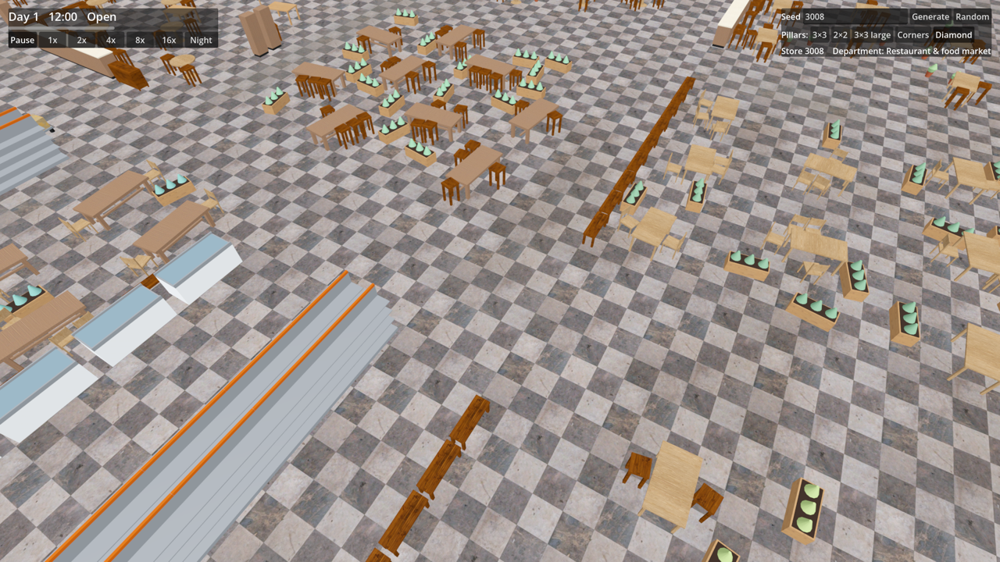 | 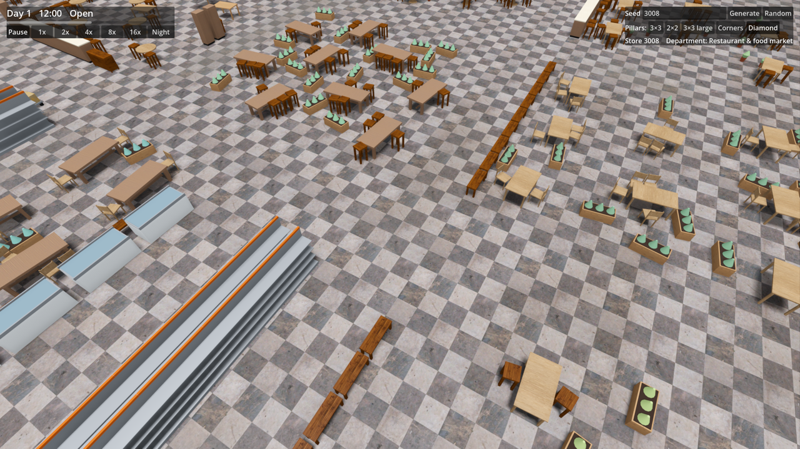 |
| Default (45 m) | 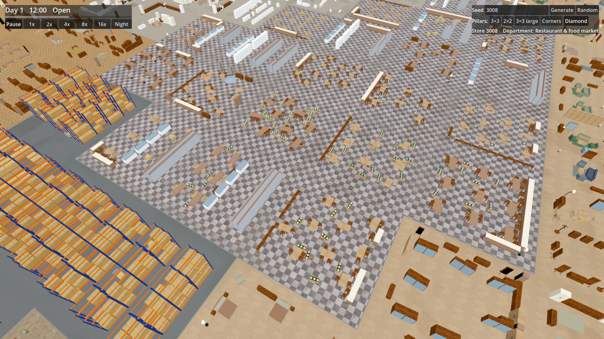 | 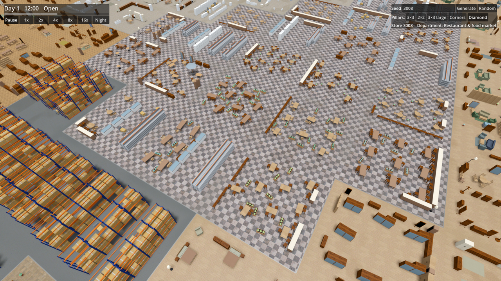 |
| Far (150 m) | 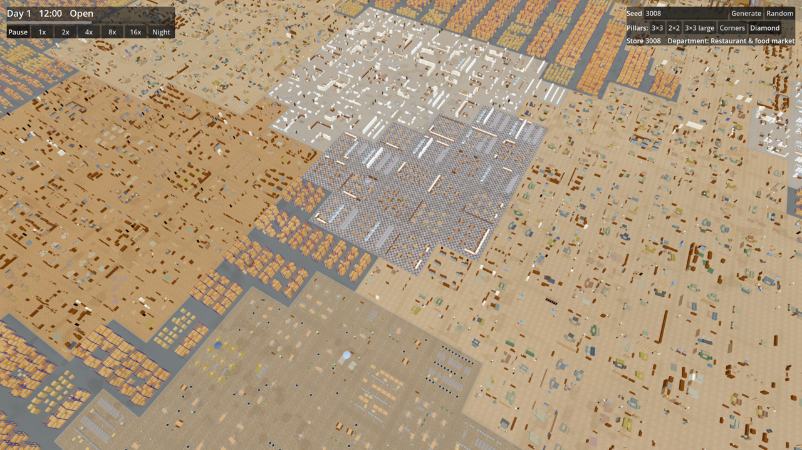 | 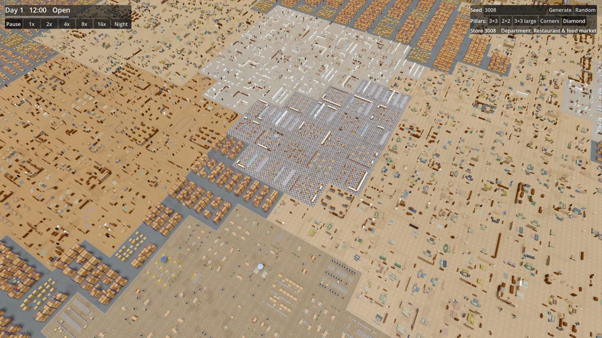 |
| Eye level | 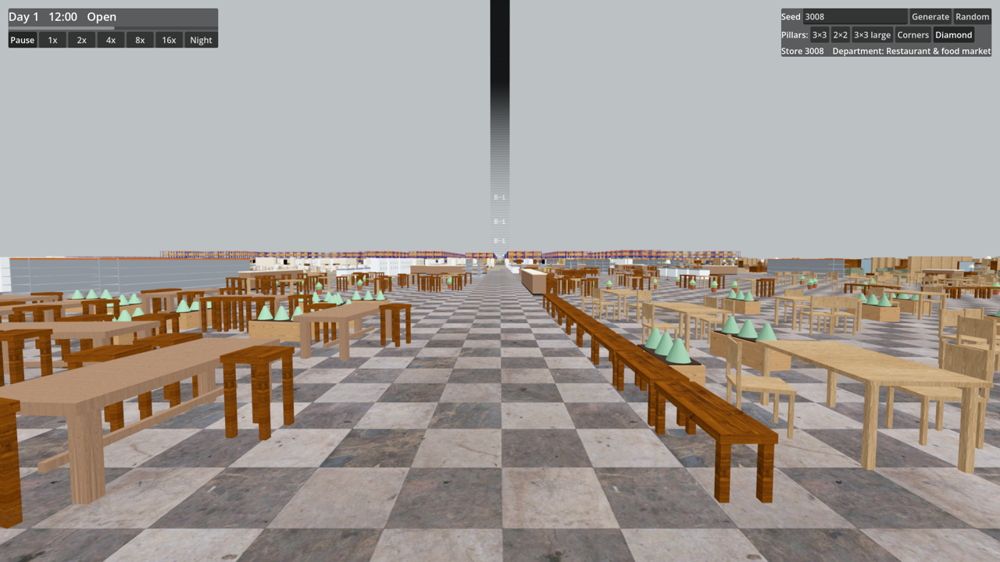 | 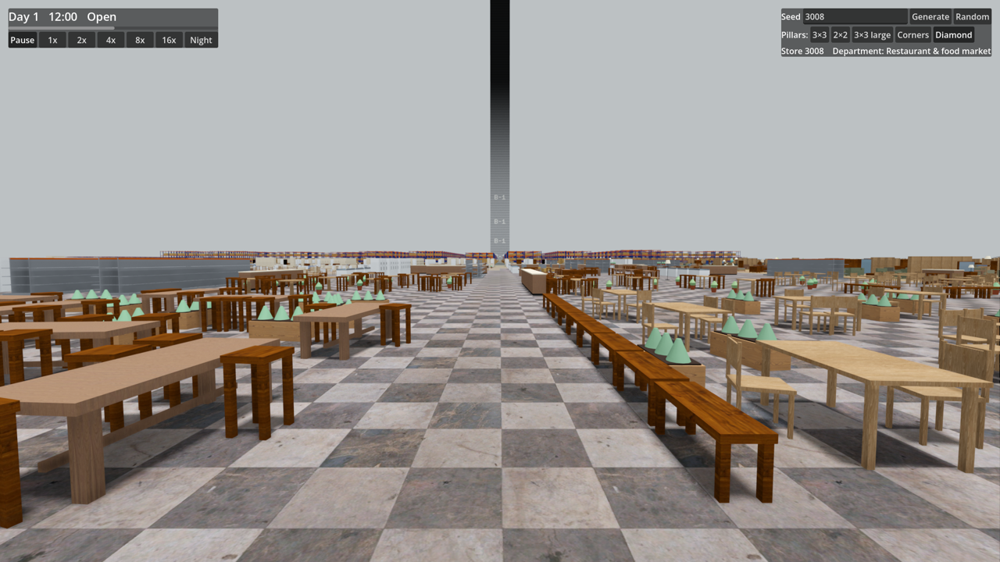 |

Near crop, before | after (an earlier pass with PCSS): 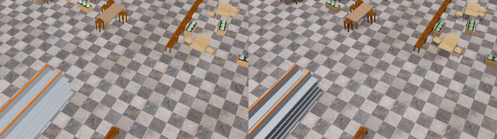

Closing time (log: `shadows False`, `SSAO False`): 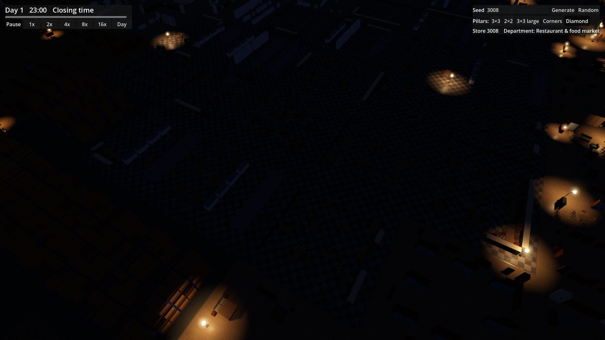
Overview (log: `shadows False`): 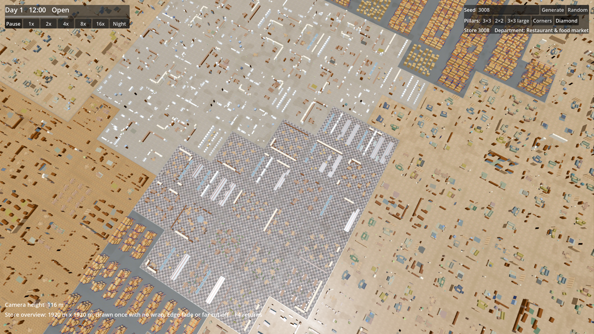

## Needs human review

- Whether the shadows read strongly enough. They are deliberately short and soft under a near-vertical light, so they are subtle at the default zoom.
- Acne, peter-panning and cascade seams in motion, especially while zooming through the split distances. None showed in the stills.
- Whether the shadow fade at the reach edge is visible while zooming.
- The SSAO halo around tall Furniture at eye level, and whether open-Store brightness still feels right (slightly darker by measurement).
- Shadow and SSAO fading during the Closing-time flicker.
- Fps on the reference machine in normal play (only the benchmark path was measured).
