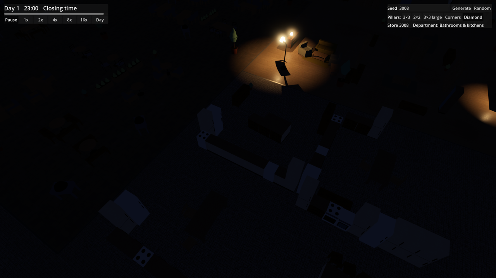
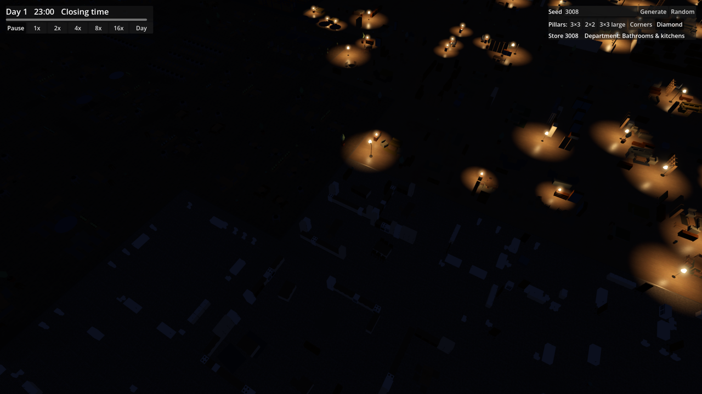
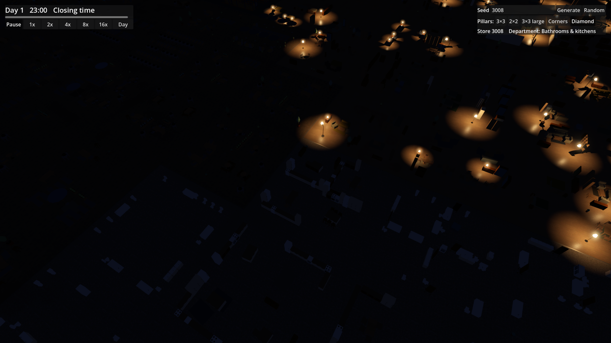
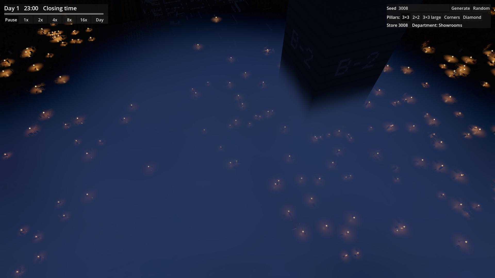
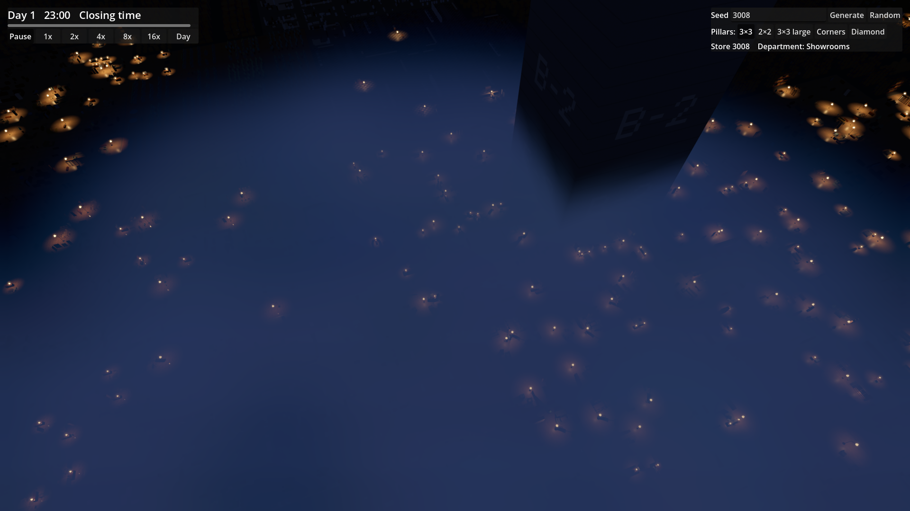

# Ticket 06i verification: more shadow-casting Lamps at Closing time

## What changed

- `LampLights.ShadowBudget` is **64** (was 4): the 64 Lamps nearest the camera (with hysteresis) get a shadowed OmniLight3D (dual-paraboloid, bias 0.05).
- Shadows no longer fade towards the nearest unshadowed Lamp. Each shadow slot fades its opacity over `ShadowFadeSeconds` (0.4 s): up to 1 while its Lamp is among the chosen casters, down to 0 when it drops out, and only then is the slot handed to the waiting Lamp, which fades in from 0. A slot is freed at once only when its Lamp loses its real light, and every way that happens is invisible: the light's whole sphere has left the view, the Lamp is at or beyond the real-light cutoff where the real light's weight has already smoothed to 0 and its pool has fully taken over, or the Lamp has no light left. So no visible shadow appears or vanishes at once. The nearest Lamps at the default view now reach shadow opacity 1.
- The positional shadow atlas is 8192 px with all four quadrants subdivided into 4×4 (16 slots each, 64 slots of 1024 px, about 128 MB). The uniform layout stops Godot from moving lights between quadrants of different sizes as their on-screen size changes, which redrew their shadow maps; a 32-shadow budget failed the gate in the default atlas and passed in this one.
- A real light is moved (and its range set) only when the Lamp it serves changes, because moving a shadowed light redraws its shadow map.

## Benchmark (RTX 2070 Super, 1080p, MSAA 4x, TAA, 20 s each)

| Measurement | Before (HEAD b7c93b7, 4 shadows) | After (64 shadows) |
|---|---|---|
| Open | 134.6 / 68.0 | **152.7 / 75.6** |
| Closing time | 183.9 / 84.8 | **155.8 / 66.9** |
| Closing time far | 109.3 / 86.0 | **124.3 / 97.0** |
| Closing time at LOD switch | 110.9 / 89.6 | **121.2 / 90.4** |

Average / 1% low fps. The benchmark PASSES the 90 / 60 gate and every measurement meets the 120 target. Open has no Lamp lights, so its change is run-to-run variance; the far views gain from fewer light moves and shadow redraws.

Budget sweep (Closing time average / 1% low, the tightest measurement):

| Budget | Atlas | Closing time | Result |
|---|---|---|---|
| 16 | default (4096, mixed) | 163.0 / 71.3 | pass |
| 24 | default | 156.8 / 67.8 | pass |
| 32 | default | 142.3 / 59.3 (149.8 / 59.3 with the move fix) | FAIL |
| 32 | 8192, 4×4 per quadrant (1024 px) | 153.8 / 68.9 | pass |
| 48 | 8192, 4×4 per quadrant | 154.1 / 61.6 | pass |
| 64 | 8192, 4×4 per quadrant (three runs + final) | 153.6 / 61.3, 157.6 / 72.7, 158.5 / 68.5, 155.8 / 66.9 | pass |
| 96 | 8192, 8×8 per quadrant (512 px) | 129.5 / 42.0 | FAIL |

64 is the largest budget that passed every run. 64 fills the 1024 px layout exactly; any larger budget (65–95 included) needs the next subdivision, 8×8 per quadrant with 512 px slots, which is the layout that failed at 96, so budgets in between were not tried. The shadow cost is CPU render time for the shadow passes (1.8 → 3.1 ms at Closing time).

## Captures (Closing time, before | after)

| View | Before | After |
|---|---|---|
| Near (15 m): 3 lights, all shadowed, opacity 1 in both |  |  |
| Default (45 m): 39 lights; before 4 shadowed at opacity 0, after 39 shadowed at opacity 1 |  |  |
| Benchmark mid zoom |  |  |

Mean luma: near 7.8 → 7.8, default 9.7 → 9.4 (the Furniture shadows darken the pools slightly). Capture fps: near 277 → 306, default 232 → 252.

Lamp-reproduction pan (`--lamp-reproduction`): the tracked Lamp's shadow opacity rises 0.02 → 0.45 → 0.92 → 1.00 over successive sampled frames as it gains a slot and stays at 1 out to 228 m; per frame up to 27 slots are mid-fade and none jumps between 0 and 1.

## Needs human review

- Pops in motion: panning and zooming at Closing time, especially fast zooms where many slots change hands (the 0.4 s fade should hide them; check it does not look like a lag).
- Shadow resolution (1024 px per light) and softness at near zoom; acne or peter-panning on Furniture and Pillars (none showed in the stills).
- Whether 64 shadows look right at the default view and how far out the shadowed/unshadowed difference is noticeable.
- Fps on the reference machine in normal play (only the benchmark path was measured), and VRAM use of the 8192 atlas on smaller GPUs.
