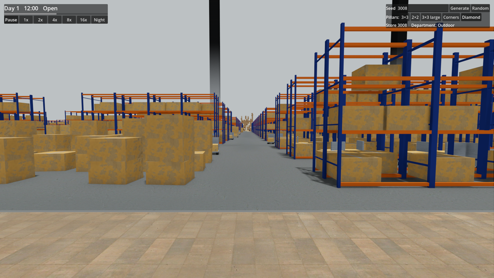
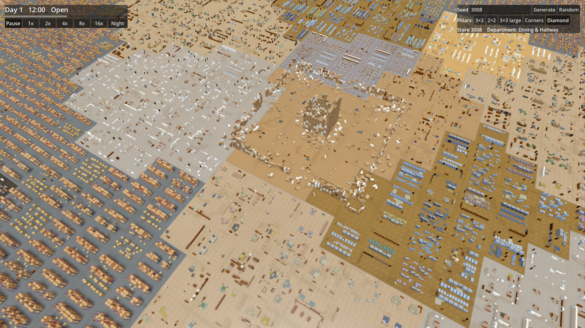
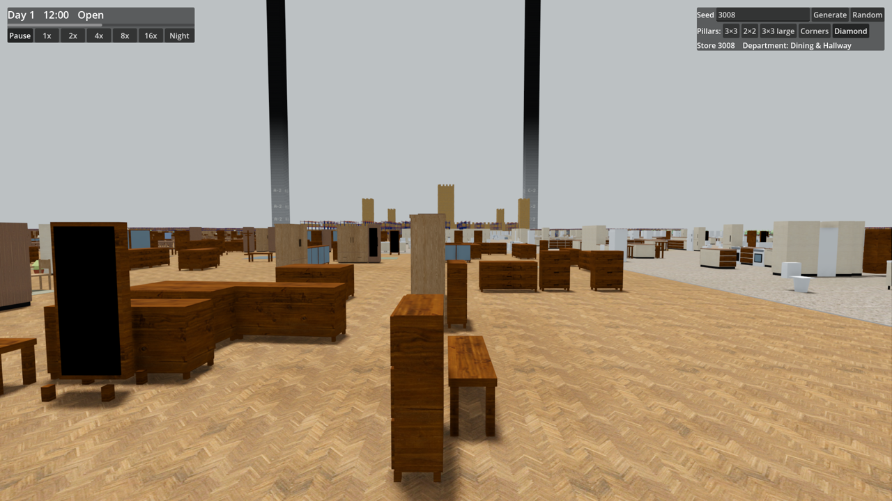
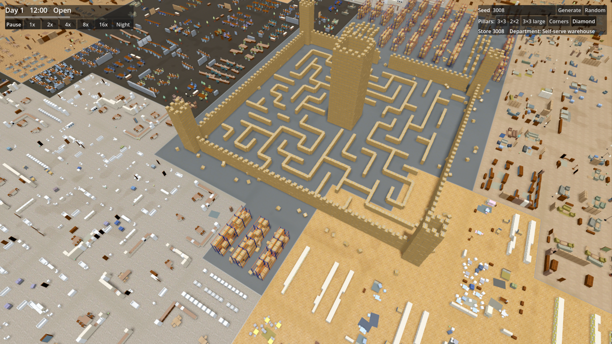
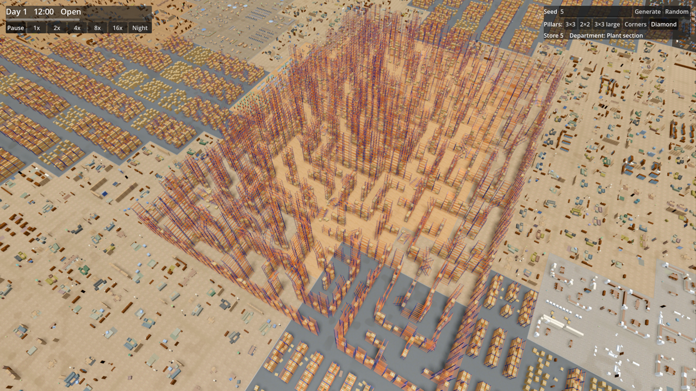
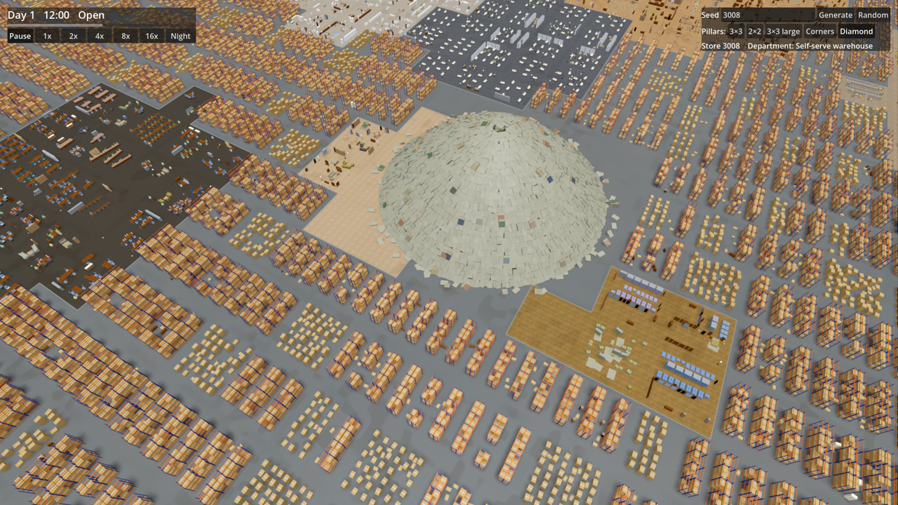

# Ticket 07 verification: Landmarks I

Placement, the ruined Village, the rack canyon, the box fort and the mattress mountain.

## What was built

- **Core** (`Landmark.cs`, `Generation/LandmarkGenerator.cs`). `WorldSnapshot.Landmarks` lists each Landmark with its type, Sector, rectangle, height and Lookouts. Every piece is an ordinary `FurniturePiece` with `LandmarkId` set and `DisplayId` -1. Pieces can now lie tipped over (`FurniturePiece.Tilt`). There are two new Furniture types, `Mattress` and `CardboardBox`, which only Landmarks use.
- **Placement.** Landmarks are planned before the Displays. Their rectangles join the Pillar keep-clear rectangles, so no Display Furniture enters them.
- **Ruined Village:** breached curtain walls, toppled corner towers, the stump of a keep and rubble, built from mixed Furniture. It is about 22 m high.
- **Rack canyon:** a 26 × 18 maze of pallet-rack stacks, with tilted racks for slopes and collapsed walls. It has three Lookouts on rack towers and is about 23 m high.
- **Box fort:** cardboard-box curtain walls with towers, a maze inside and a keep 30 boxes high (about 25 m).
- **Mattress mountain:** a heap of mattresses about 24.6 m high, with a Lookout on the summit and Beds at its foot.
- **Godot.** Landmark Furniture renders in its own instance groups. They draw out to 1200 m, like the Pillars, so the Landmarks show above the shelving and the Fog banks. They are wrapped, so they render across the Seams. There are meshes for Mattress (fabric body and bedding top) and CardboardBox (box with a tape strip). `DevCapture` gained `--yaw=degrees`.

## Decisions

- **Random streams.** Stream 4 plans the Landmarks. Stream 5 plus the Landmark id builds each one, so changing one Landmark's builder does not move the others.
- **Which Landmarks a world has.** The Village is always present. The rack canyon, box fort, mattress mountain, dead zone, clock wall and fountain court always appear too, in shuffled order (if there are fewer Sectors than Landmarks, the surplus ones are dropped, never the Village).
- **Sectors.** Pillar-less Sectors are shuffled and used first, then Pillar Sectors.
- **Rectangle sizes:** Village 96 × 96 m, canyon 160 × 112 m, fort 80 × 80 m, mountain 80 × 80 m. Every size is within ¼ of the smallest Sector (448 m). Each rectangle sits on the department-cell grid, at least one cell from the Sector edges and one cell beyond the Pillar's walkway ring.
- **Pieces.** Landmark pieces come after the Display pieces in `WorldSnapshot.Furniture`, so Ids stay equal to indices.
- **Furniture test changes.** Display-only tests (theme strictness, palettes, floor overlap, raised support) now skip Landmark pieces. The accent-share bound went from 0.30 to 0.33: removing Displays under Landmarks left Desk at 31 % of KidsBedroom on one seed. The bound only guards against one accent type dominating a Theme.
- **No ADR.** Every choice is a tuning constant or local to the generator.

## Tests

- `LandmarkTests` adds 17 facade tests. They cover determinism across runtime seeds and time, that the Village is always present while the seed picks the others, and the placement rules on all five Pillar layouts. They also check that pieces are marked individual Furniture inside the rectangle and above the floor, that each Landmark is at least 20 m high, that no Display Furniture is inside a Landmark, the per-type composition and Lookouts, and the tilt geometry.
- The full suite passes: 279/279. The Godot headless `--build-solutions` and the game's `dotnet build` both finish with 0 warnings and 0 errors.

## Benchmark (RTX 2070 Super, 1080p, MSAA 4x, TAA, 20 s each)

| Measurement | 06i | 07 |
|---|---|---|
| Open | 152.7 / 75.6 | **135.6 / 72.0** |
| Closing time | 155.8 / 66.9 | **150.3 / 68.1** |
| Closing time far | 124.3 / 97.0 | **106.2 / 91.1** |
| Closing time at LOD switch | 121.2 / 90.4 | **105.9 / 78.2** |

Values are average / 1% low fps. The benchmark **PASSES** the 90 / 60 gate. The far views lose about 15–18 fps, because the Landmarks (several thousand pieces each) stay drawn out to 1200 m; they drop below the 120 target but stay above the gate. [Benchmark log](screenshots/07/benchmark.txt).

## Screenshots

| | |
|---|---|
| Village from eye level, far down an aisle above the racks (72.7 fps) |  |
| Ruined Village from above (98.4 fps) |  |
| Box fort towers seen across the north Seam from eye level (74.6 fps) |  |
| Box fort (129.9 fps) |  |
| Rack canyon, seed 5 (95.7 fps) |  |
| Mattress mountain (94.5 fps) |  |

## Needs human review

- Whether each Landmark reads as intended up close and in play. The Village should look like a ruined castle, the canyon should look collapsed rather than just a maze of racks, and the mountain's mattress colours look pale and uniform from above.
- Fps at eye level with a Landmark in view: 72–75 fps in the captures, against 144–160 without one. It is not measured by the benchmark path.
- Climbability of the canyon slopes and Lookouts, and of the mountain. Climbing is not simulated yet; only the geometry exists.
