# Ticket 08b verification: Points of interest II

Ball pits, the armchair henge, the EXIT sign, mannequins, the door to nowhere, the aquarium and the abandoned scaffold.

## What was built

- **Core** (`PointOfInterest.cs`, `Generation/PointOfInterestGenerator.cs`). Seven new `PointOfInterestType`s: `BallPit` (exactly 3 per Store), `ArmchairHenge`, `ExitSign`, `MannequinCrowd`, `DoorToNowhere`, `DisplayAquarium` (1–2 each) and `AbandonedScaffold` (exactly 1). They are planned with the common Points of interest, before the Displays, under the same rules: one per Department cell, clear of Landmarks, Pillars and walkway rings.
- **Ball pit network.** `WorldSnapshot.BallPitNetwork` lists the three Ball pits. `WorldSnapshot.StaffExitsFrom(poiId)` returns the other two at Closing time and nothing while the Store is open. There is no Villager API: Villagers can never pass.
- **Abandoned scaffold.** It is the one Point of interest on a walkway ring. It records its Pillar (`PointOfInterest.PillarId`) and its top (`PointOfInterest.Lookout`). It is an L-shaped stair of stacked Furniture that climbs one face of the Pillar, turns the corner and stops abruptly at about 9.6 m. Every other walkway ring stays Furniture-free.
- **New Furniture types:** `BouncyCastle`, `ExitSign`, `Mannequin`, `DoorFrame` and `Aquarium`. The henge reuses armchairs, and the scaffold reuses ordinary Furniture.
- **Godot** (`FurnitureMeshes.cs`, `furniture.gdshader`):
  - **Ball pit:** an inflated floor, corner towers with cone tops, net walls, an open rim, and balls heaped above the walls.
  - **EXIT sign:** "← EXIT" in a pixel font on both faces of a green panel on posts.
  - **Mannequin:** a dark suit and a faceless head on a chrome stand.
  - **Door frame:** jambs, a head and a threshold.
  - **Aquarium:** a cabinet, a water volume, gravel and 18 fish.
  - **Steady glow.** The EXIT sign and the aquarium water glow at a fixed strength, which is not scaled by the Lamp level. Full materials set `lamp_glow = false`; coarse meshes look up a new `part_glow` table.
- **Stage review (06–08b).** The review of the whole Landmarks stage found no missing requirement. It fixed docs that had drifted:
  - GLOSSARY: Display and Lookout.
  - `FurniturePiece.DisplayId` and `FurnitureSpec.LightRadius` docs.
  - The Pillar layouts named in ADR 0003.
  - A README section on the Landmark and Point of interest facade members.
  - The cross-reference between the shader part tables and `PartSlots`.
- **Generation tests and tilt.** `StoreGenerationTests` now takes tilt into account: a tipped-over piece (the henge's fallen armchair, the scaffold's flat wardrobes) counts as raised only if its lowest corner is off the floor, and its footprint reaches along its front.
- **Stage fix (08).** The WallClock's round dial was built from overlapping boxes, which the coplanar check flagged as z-fighting. It is now built from non-overlapping slabs.

## Decisions

- **Roles not simulated yet.** Beliefs, Restock, food, water and fabric sources, and a Village finishing the scaffold are documented on the types. They are not simulated in this ticket.
- **Scaffold rectangle.** The scaffold's rectangle is the bounding box of its L-shaped stair. It is exempt from the walkway-ring rule only on its own Pillar. The box also covers a corner of the Pillar itself, where nothing can stand anyway. Every step must fit in it: generation fails rather than silently dropping one.
- **Ball pit play cubes** stand one to a metre-wide slot, so they never overlap.
- **Shape of the scaffold.** It climbs one face, turns one corner and stops: a half-finished spiral.
- **Ball pit placement.** Ball pits prefer Kids' area Departments.
- **Mannequins** wear a dark suit with a faceless head, so that they read as Staff from afar.
- **Steady glow** is a per-part shader table, not a Lamp-scaled emission. The EXIT sign and the aquarium stay lit at Closing time without adding lights.
- **No ADR.** Every choice is local to the generator or the mesh builder.

## Tests

- `PointOfInterestTests` covers the new kinds:
  - the same seed and layout give the same Points of interest;
  - the counts per kind are right on all five Pillar layouts;
  - the Ball pit network holds exactly the three Ball pits and opens only at Closing time;
  - the scaffold stands on exactly one Pillar's walkway ring and has a Lookout;
  - every other walkway ring stays Furniture-free.

  `PillarTests` and `PillarLayoutTests` now exempt only the scaffold from the walkway-ring rule.
- **Full core suite:** 340/340 pass. The game project builds with `dotnet build` and with the Godot 4.7.2 console executable in headless mode (`--build-solutions`), with no errors or warnings.
- **Mesh checks:** the coplanar check passes (after the WallClock fix), the silhouette check passes for 101 types and variants with 0 failures, and the coarse-colour check passes.

## Benchmark (RTX 2070 Super, 1080p, 20 s each)

| Measurement | 08 | 08b |
|---|---|---|
| Open | – | **147.8 / 82.7** |
| Closing time | – | **151.4 / 63.5** |
| Closing time far | 117.8 | **119.1 / 89.2** |
| Closing time at LOD switch | – | **121.9 / 74.5** |

Values are average / 1% low fps. The benchmark **PASSES** the 90 / 60 gate. Only the far view is just below the 120 target, as it was in ticket 08. See the [benchmark log](screenshots/08b/benchmark.txt).

## Screenshots (seed 3008, DiamondLarge)

| | |
|---|---|
| Ball pit (308 fps) | 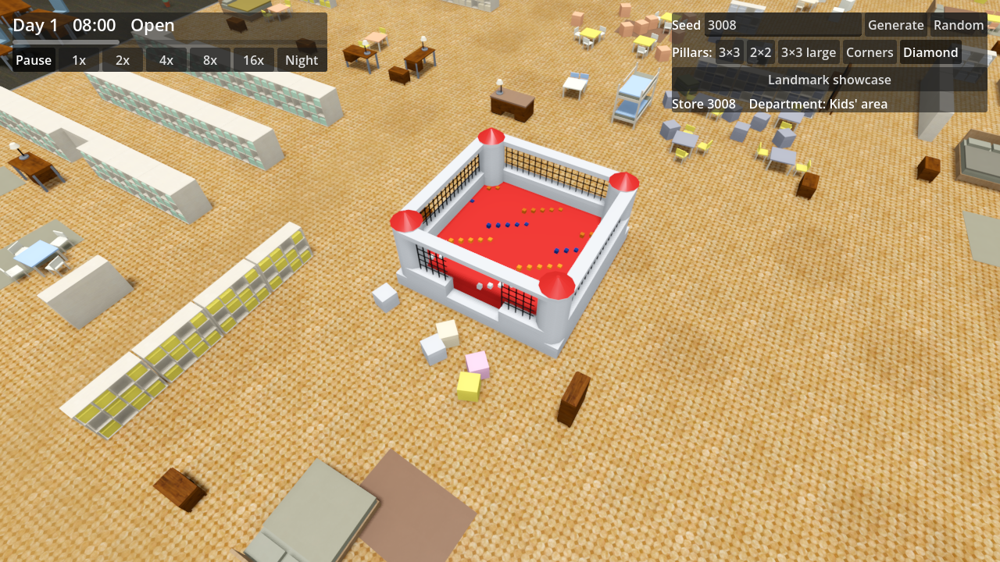 |
| Ball pit across the west Seam (200 fps) | 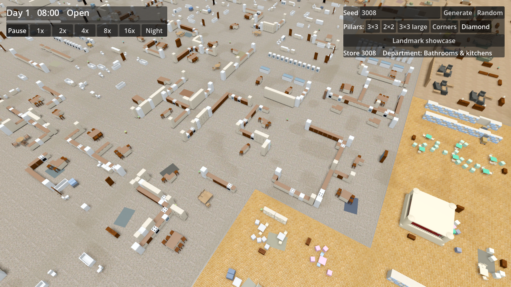 |
| Armchair henge (241 fps) | 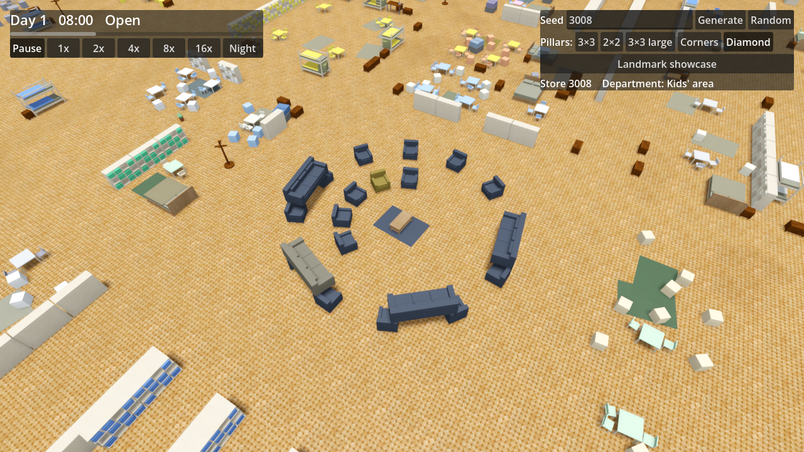 |
| EXIT sign, open (288 fps) | 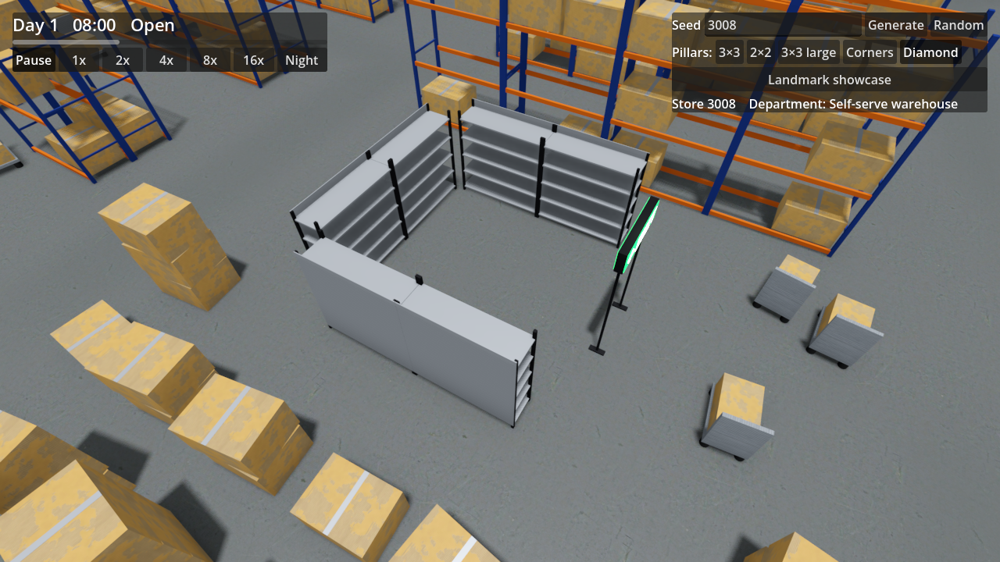 |
| EXIT sign, Closing time (462 fps) | 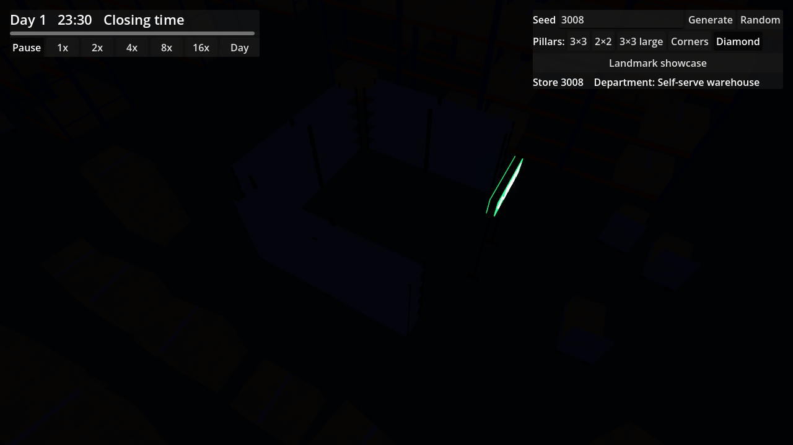 |
| EXIT sign at eye level (79 fps) | 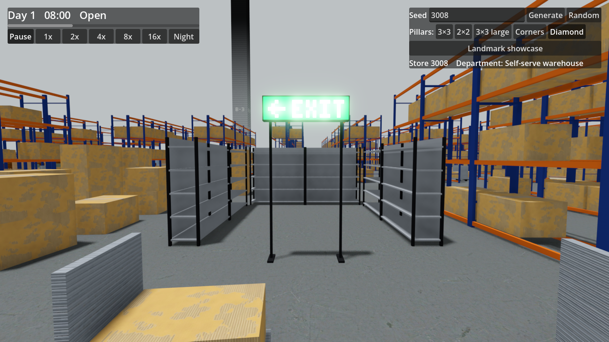 |
| EXIT sign at eye level, Closing time (76 fps) | 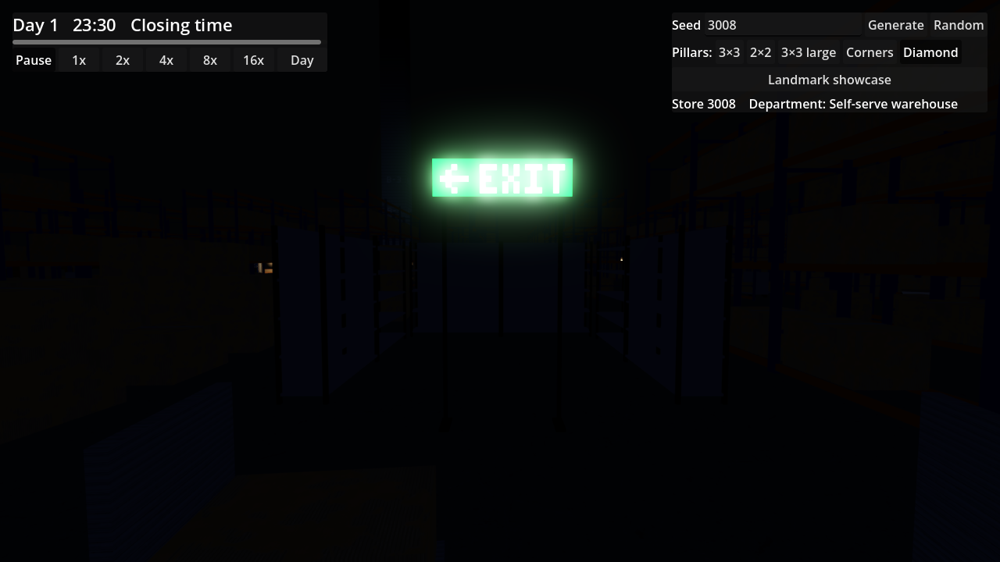 |
| Mannequin crowd (334 fps) | 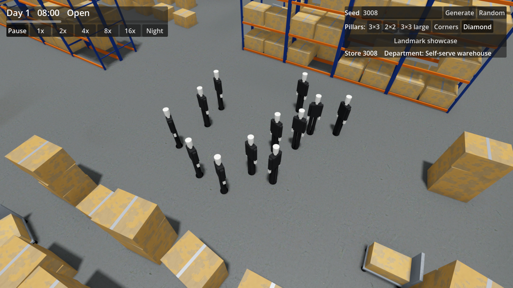 |
| Door to nowhere (324 fps) | 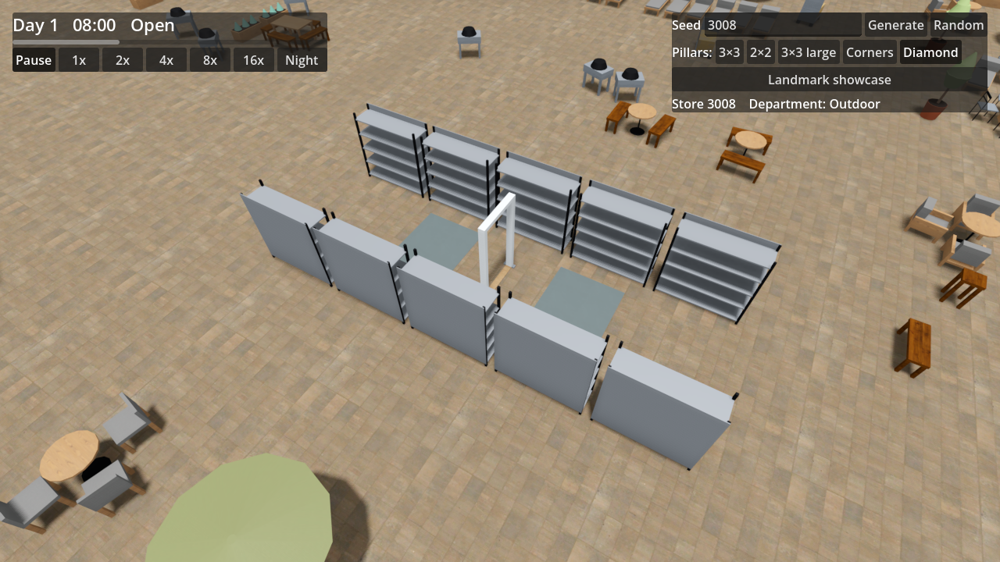 |
| Display aquarium (282 fps) | 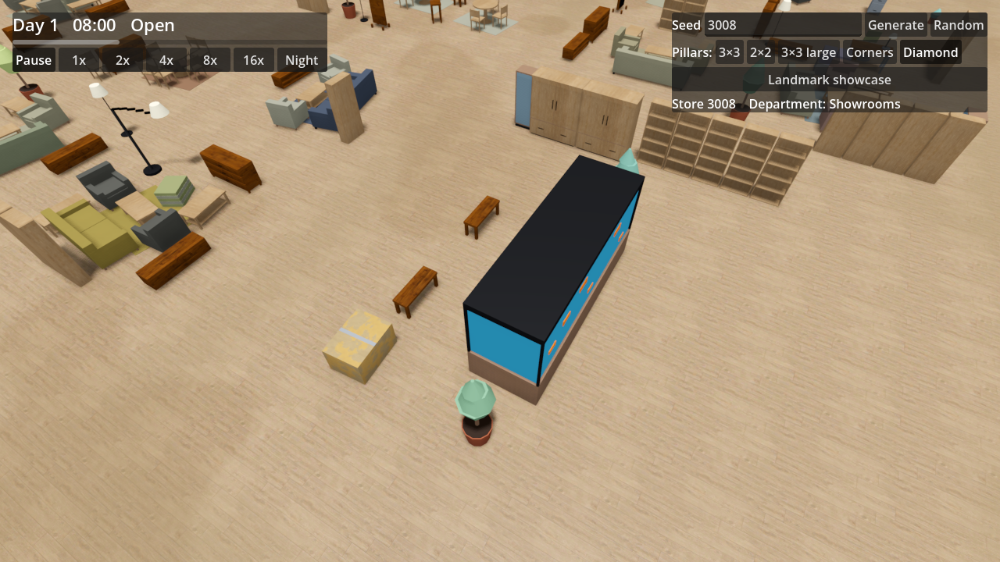 |
| Display aquarium, Closing time (448 fps) | 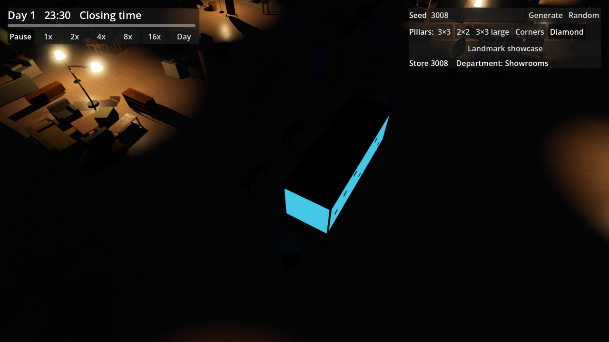 |
| Abandoned scaffold on Pillar A-2 (286 fps) | 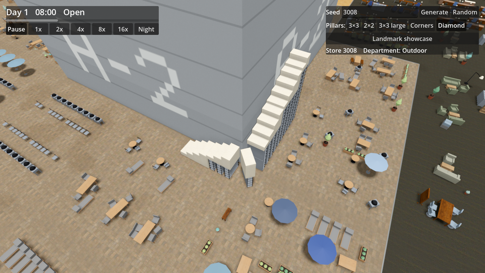 |

## Needs human review

- Whether each Point of interest reads as intended up close and in play: the Ball pit as a bouncy castle full of balls, the mannequins as Staff from afar, and the door frame as a door to nowhere.
- The strength of the EXIT sign and aquarium glow at Closing time, against the Lamp-lit surroundings.
- Fps at eye level: 76–79 fps in the captures, the same as earlier tickets. The benchmark path does not measure it.
- How climbable the scaffold is. Climbing is not simulated yet; only the geometry exists.
