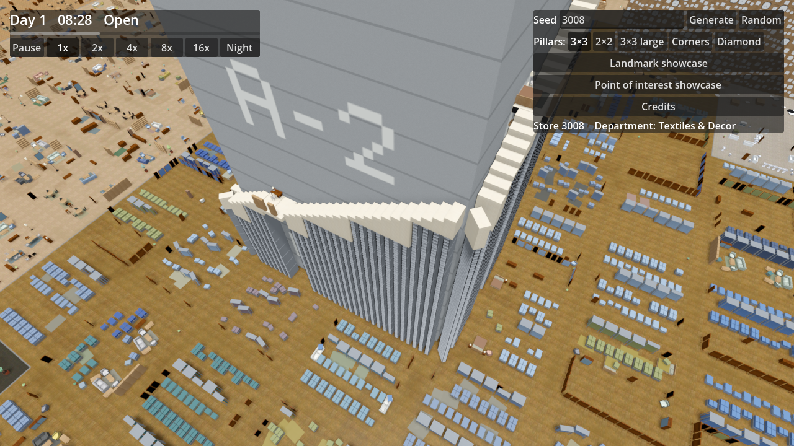
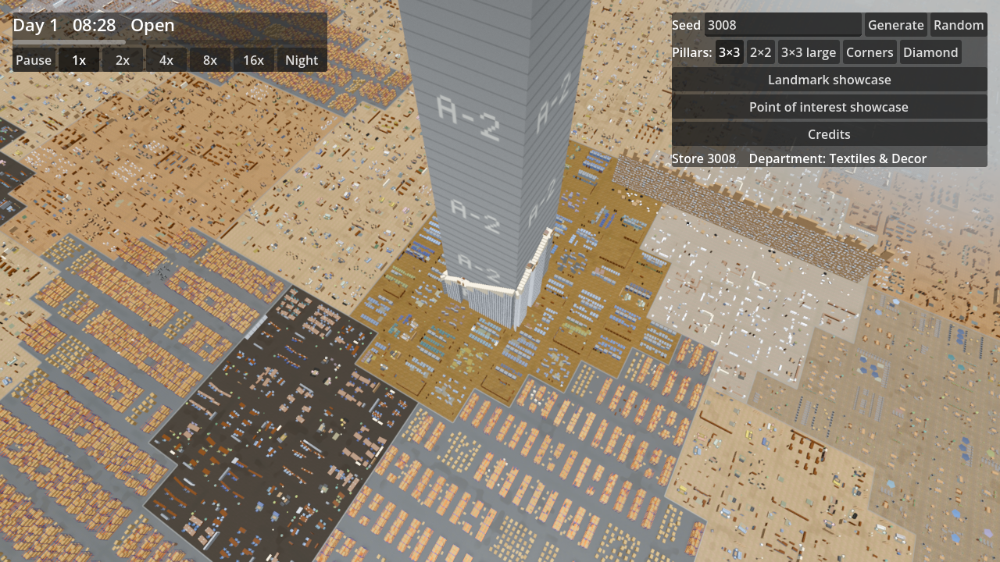
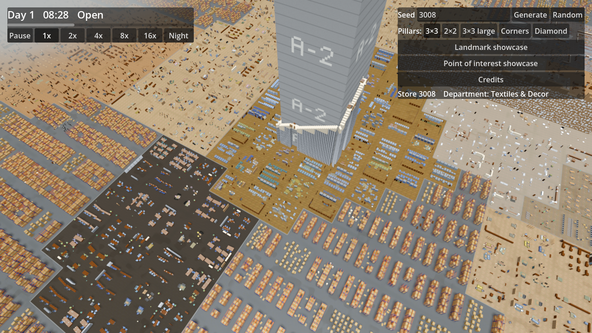
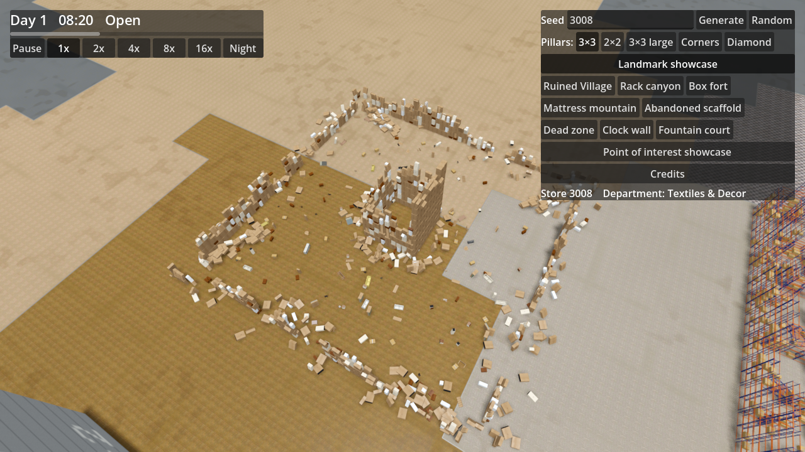

# Ticket 08d verification: the abandoned scaffold becomes a Landmark

## What was built

- **Core** (`Landmark.cs`, `PointOfInterest.cs`, `Generation/LandmarkGenerator.cs`, `Generation/PointOfInterestGenerator.cs`).
  - `AbandonedScaffold` moved from `PointOfInterestType` to `LandmarkType`.
  - `Landmark.PillarId` records the Pillar it climbs. `PointOfInterest` lost `PillarId` and `Lookout`.
  - Every world has exactly one scaffold, on top of the one-Landmark-per-Sector limit.
- **Site.** The scaffold's Landmark rectangle is its Pillar with the walkway ring (38 × 38 m). That is exactly the square the Displays and Points of interest already kept clear of.
  - Its site is drawn last in the Landmark plan stream, so every other Landmark, Point of interest and Display of a seed is unchanged.
  - The build random picks the Pillar, the starting face, the direction (mirrored or not), the height and the rooms.
- **Shape.** A stair of Furniture climbs along the middle of the walkway ring:
  - one step per metre, each rising 0.6 m;
  - each step is a column of wardrobes laid flat, with shelf units standing in for wardrobes in pairs lower down;
  - it takes one diagonal step across each corner and winds round several faces;
  - it has 67–92 steps, so its top room's floor is 40–55 m up and its Furniture stays under 60 m.
- **Rooms.** 3–6 rooms along the stair, the top one included. Each:
  - spans the ring's full 3 m width over 4 m of one face, and never turns a corner;
  - has a floor of 2 × 3 wardrobes laid flat, propped on two bookcases leant against the Pillar;
  - has an outer wall of bookcases with gaps and an optional rug;
  - holds a bed with a floor lamp and a chair, or a desk with a desk or floor lamp and a chair.

  The stair ends in the top room, which holds the Lookout on its floor.
- **LandmarkBuilder.** `Put` keeps pieces flush with the Landmark's edge (a 1 mm tolerance), because the scaffold's pieces touch the ring's outer edge and the Pillar's face. If a piece of the scaffold does not fit, generation fails rather than leaving a hole in the stair.
- **Showcases.**
  - The Landmark showcase puts the scaffold on the Pillar nearest the middle of its row.
  - The Point of interest showcase no longer has it.
  - In the seed panel, the "Abandoned scaffold" Landmark button flies the camera back by the scaffold's height, so the whole tower is in view.
- **Game.** The FurnitureRenderer already draws Landmark Furniture out to the Landmark distance and across the Seams, so the scaffold now shows from afar like the other Landmarks.
- **Docs.** GLOSSARY.md (Pillar, the two showcases), README.md, `WorldConfig` docs. No ADR: every choice is local to the generator.

## Tests

- `LandmarkTests` checks the scaffold on 10 layout/seed pairs covering all five Pillar layouts:
  - it is one Landmark per world, not a Point of interest;
  - every piece is within the walkway ring;
  - it winds round at least 3 faces;
  - it has 3–6 beds or desks at distinct heights, each with a chair and a lamp;
  - it has one Lookout 40–60 m up, in the topmost room, with its height under 60 m;
  - no other Furniture stands on any walkway ring.

  Other `LandmarkTests` cover:
  - same seed, same scaffold; the scaffold varies with the seed;
  - the composition (at least 80% wardrobes and shelf units);
  - the Landmark showcase.
- `PillarTests`, `PillarLayoutTests` and `PointOfInterestTests` now take the scaffold as a Landmark.
- **Full core suite: 354/354 pass.** The game builds with `dotnet build` (0 warnings) and with the Godot 4.7.2 console executable headless (`--build-solutions`).

## Benchmark (RTX 2070 Super, 1080p, 20 s each)

Values are average / 1% low fps.

| Measurement | Baseline (HEAD before 08d) | 08d |
|---|---|---|
| Open | 113.5 / 67.7 | **113.9 / 66.5** |
| Closing time | 139.2 / 66.9 | **141.2 / 69.0** |
| Closing time far | 95.4 / 78.7 | **98.4 / 82.0** |
| Closing time at LOD switch | 85.7 / 68.1 | **90.8 / 73.8** |

- Both columns were measured in the same session.
- **With 08d the benchmark PASSES** the 90 / 60 gate. The baseline failed it at the LOD switch, so the difference is within run-to-run noise: the scaffold costs nothing measurable.
- Three of the four measurements are below the 120 target both before and after this ticket. This drop happened before 08d; it is lower than the 08b numbers.

See the [benchmark log](screenshots/08d/benchmark.txt).

## Screenshots (seed 3008, 3 × 3)

| | |
|---|---|
| Up close on Pillar A-2 (130 fps) |  |
| From afar (87 fps) |  |
| Across the west Seam (75 fps) |  |
| Landmark showcase with its Abandoned scaffold button |  |

## Needs human review

- Whether the stair and rooms read as a half-finished scaffold with bolted-on rooms up close: the wardrobe step columns form a solid wall along the ring.
- The rooms' furnishing at eye level.
- The showcase camera framing on the Abandoned scaffold button.
- The general fps level below the 120 target, which was already there before this ticket.
- Climbing and a Village finishing it as a Pillar scaffold are not simulated yet.
