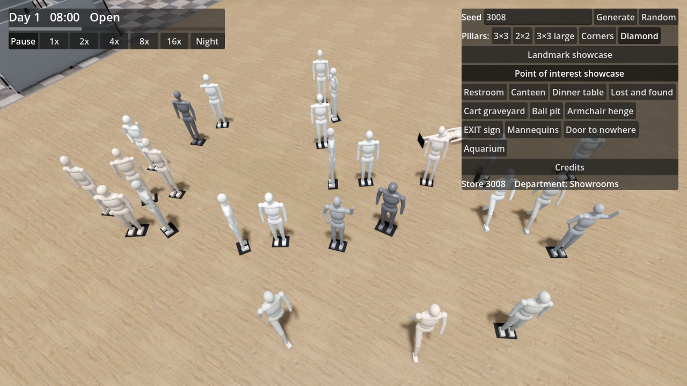

# Ticket 08e verification: Mannequin crowd, bare plastic shop mannequins, three times as many

## What was built

- **Core** (`Furniture.cs`, `Generation/PointOfInterestGenerator.cs`).
  - The Mannequin has six variants: 0 arms down, 1 one arm raised and a hand on the hip, 2 mid-stride, 3 tall and slim, 4 short and broad, 5 missing its left arm.
  - A Mannequin crowd holds 24–42 mannequins. Its rectangle grew from 7 × 6 m to 12 × 9 m to fit them.
  - Each crowd has one fallen mannequin (laid on its front with `Tilt`) and, half the time, one with a missing arm.
  - The rest stand in a random pose and build, with one of 12 plastic colours. About three in four face the crowd's way (within 0.25 rad); the rest face at random.
  - Placement is rejection sampling on bounding discs plus a small spacing, so none overlap. The counts and placement rules of the crowds per Sector and Store are unchanged.
- **Game** (`FurnitureMeshes.cs`). The model is procedural: tapered tubes and ellipsoids (new `Builder.Tube` and `Builder.Ellipsoid`, boxes in the coarse LOD) for head, neck, torso, hips, arms and legs, on a dark foot plate. No external model, so nothing to credit in `CREDITS.md`.
- **Dev tools.** `--poi=<Type>` in `DevCapture` starts the camera on a Point of interest; the showcase no longer flies the camera away when a dev capture names its focus.
- **Docs.** GLOSSARY.md (Mannequin crowd). No ADR.

## Decisions

- Procedural geometry rather than a downloaded model: no licence or download risk, and the model matches the Furniture pipeline (tint, coarse LOD).
- "Scuffs" are approximated by dingier plastic colours in the palette; there is no per-mannequin scuff texture.
- The larger crowd footprint can shift other Points of interest of the same seed. The counts and rules are unchanged.

## Tests

- New facade-level theory in `PointOfInterestTests` on every Pillar layout and several seeds: 1–2 crowds, 24–42 mannequins each, at least 3 poses and 3 plastic colours, exactly one fallen figure, no overlaps, most upright figures facing one way.
- Full core suite: 369/369 pass. The game builds with `dotnet build` (0 warnings) and with the Godot 4.7.2 console executable headless (`--build-solutions`).

## Benchmark (RTX 2070 Super, 1080p, 20 s each; average / 1% low)

| Measurement | HEAD before 08e | 08e |
|---|---|---|
| Open | 112.8 / 61.0 | 114.1 / 62.9, 113.9 / 67.8 |
| Closing time | 135.2 / 58.9 | 137.8 / 64.6, 136.1 / 57.7 |
| Closing time far | 96.2 / 84.7 | 98.4 / 82.0, 95.4 / 79.3 |
| Closing time at LOD switch | 87.6 / 66.0 | 88.5 / 73.2, 85.8 / 66.2 |

- The benchmark gate (90 / 60) fails at the LOD switch both before and after this ticket; the difference between the two is within run-to-run noise (08e was run twice). The crowds are not in view in the benchmark scenes.
- The crowd itself was not measured under load; it is about 40 figures of a few hundred triangles each.

## Screenshot

Point of interest showcase, Mannequin crowd (seed 3008): 

## Needs human review

- Whether the mannequins read as plastic shop mannequins, up close and from afar (eye level in particular).
- The poses, builds and plastic colours; the fallen and the armless figure.
- The crowd's area and whether it still looks like a crowd in a store aisle.
- The fps of a crowd in view in a real Store.
