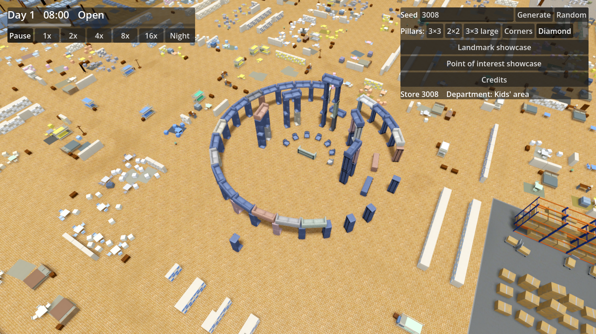

# Ticket 08f verification: Armchair henge, an unmistakable Stonehenge of armchairs and sofas

## What was built

- **Core** (`Furniture.cs`, `Generation/PointOfInterestGenerator.cs`).
  - `FurniturePiece` has a new `Roll` (about its length axis, applied before `Tilt`) so a sofa can stand on its end; `Corners` honours it.
  - The henge site is 28 × 33 m (ring about 26 m across, plus the heel stone). It is bigger than a 16 m Department cell, so it stands centred on its cell; a site is also rejected if it would leave its Sector.
  - Layout: 28 big sofas (variant 2, 2.7 m) stood on end in an outer circle at 12.4 m radius, lintel sofas across them, 3 gaps, one fallen upright and some fallen lintels; five trilithons (pairs of stacked upright sofas under a lintel, the middle one three high) in a horseshoe open towards +y; 7 armchairs facing the centre; a sofa altar on its back; a leaning heel stone on the entrance axis. Only armchairs and sofas.
- **Game** (`FurnitureRenderer.cs`). `Placement` applies `Roll`.
- **Docs.** GLOSSARY.md (Armchair henge). No ADR.

## Decisions

- A `Roll` field rather than a new Furniture type: the stones are ordinary sofas.
- The site is allowed to exceed the cell and is centred on it; counts (1–2 per Store) and the clearance rules are unchanged.

## Tests

- New facade-level theory in `PointOfInterestTests` on every Pillar layout and seeds 3008, 42, 7: count 1–2 unchanged, only Sofa/Armchair pieces, one altar, a heel stone 14.5–17 m out, 22–25 circle stones at 11.5–13.5 m, ring about 24–27 m wide, ring lintels at 2.7 m and trilithon lintels at 5.4 m and 8.1 m resting on stacked uprights, 7 armchairs, gaps and a fallen sofa.
- Full core suite: 384/384 pass. `dotnet build` of the game: 0 errors; the Godot 4.7.2 console executable loaded and ran the game (capture below).

## Benchmark (RTX 2070 Super, 1080p, 20 s each; average / 1% low)

| Measurement | 08e | 08f |
|---|---|---|
| Open | 114.1 / 62.9 | 113.6 / 65.9 |
| Closing time | 137.8 / 64.6 | 135.4 / 64.0 |
| Closing time far | 98.4 / 82.0 | 97.4 / 83.2 |
| Closing time at LOD switch | 88.5 / 73.2 | 87.0 / 72.0 |

- Unchanged from 08e, within noise. The 90 / 60 gate still fails at the LOD switch, as it did before this ticket. The henge is not in the benchmark path, so its own cost under load is not measured (about 150 sofas).

## Screenshot

Observer camera, Armchair henge, seed 3008: 

## Needs human review

- That it reads as Stonehenge at first sight, from far and close; the stacked-sofa trilithons, the fallen pieces and the heel stone.
- Frame rate with a henge in view, and across Sector seams.
