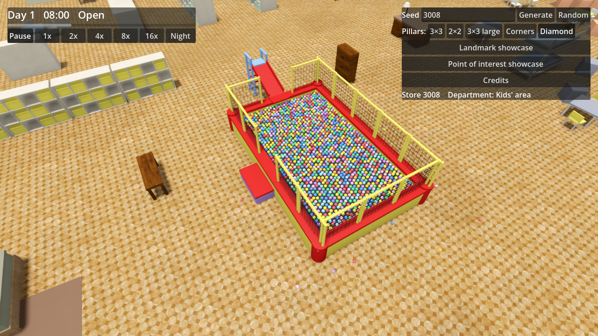

# Ticket 08g verification: Ball pit, a real ball pool instead of a bouncy castle

## What was built

- **Core** (`Furniture.cs`, `Generation/PointOfInterestGenerator.cs`, `PointOfInterest.cs`).
  - The `BouncyCastle` Furniture type is gone. Five new Ball pit-only types replace it: `BallPool` (5 × 3.2 m, 0.6 m high), `NetRailing` (1 m lengths), `PlaySlide`, `FoamStep` and `PlayBall` (8 cm).
  - Layout of each Ball pit: one pool with a random vinyl colour; 14 lengths of net railing on its walls, all one colour, with a gap at the entrance step and a gap at the slide; a foam step at the south side; a slide standing against the outside of the west wall, its chute (not part of the slide's footprint) running over the wall into the pool; a shoe cabinet and a bench beside it.
  - The pool is filled with about 1,400 balls in staggered rows at the 0.4 m fill line (small jitter, random colours). 8–20 balls are spilled on the floor around it, clear of the other pieces.
  - Counts are unchanged: exactly 3 per Store. The Ball pit network is unchanged.
- **Game** (`FurnitureMeshes.cs`). Procedural meshes for the five types:
  - the pool: padded walls under red trim cushions, corner bumpers and a dark ball bed, so the gaps between the balls read as depth;
  - the railing: padded posts and top bar with a black net;
  - the slide: ladder, deck with side rails and a red chute;
  - the step;
  - a low-poly ball, drawn as a small block in the coarse LOD.
  - Also added: new `Padding`, `PaddingTrim` and `BallBed` parts, vinyl and ball palettes, and a `Builder.Slab` for slanted slabs.
- **Docs.** GLOSSARY.md already described the Ball pit as a ball pool, so it is unchanged. No ADR.

## Decisions

- Each ball is its own `PlayBall` Furniture piece, drawn by instancing like all Furniture, with no physics. Only the top layer is placed (about 1,400 per pit, about 4,200 per Store). The dark bed inside the pool mesh stands in for the balls below.
- The pool, railing, slide, step and ball are new types used only in Ball pits, not variants of existing Furniture.
- The slide's footprint stops at the pool wall, so floor Furniture still never overlaps; only its chute overhangs into the pool.
- The Lamp-share test (3–4 %) now leaves the balls out of the total: about 4,200 tiny balls diluted it to 2.996 % without making Lamps rarer to see.
- All meshes are procedural, with no external models, so both CREDITS.md files are unchanged.

## Tests

- New facade-level tests in `PointOfInterestTests`, run on every Pillar layout and seeds 3008, 42 and 7:
  - exactly 3 Ball pits, each with only Ball pit Furniture (plus the cabinet and bench);
  - one pool, one slide and one step per pit;
  - 14 railings standing at the pool's height;
  - 300–2,000 balls inside the pool, below its rim, in at least 6 colours;
  - 5–30 balls spilled on the floor.
- Other new tests:
  - the same seed gives the same balls, and another seed gives other balls;
  - the `BouncyCastle` type no longer exists;
  - the Ball pit network test now runs on every layout and asserts 3 pits.
- Full core suite: 413/413 pass.
- `dotnet build` of the game: 0 warnings, 0 errors. The Godot 4.7.2 console executable built the project headless (exit 0) and ran the game for the capture below.

## Benchmark (RTX 2070 Super, 1080p, 20 s each; average / 1% low)

| Measurement | 08f | 08g |
|---|---|---|
| Open | 113.6 / 65.9 | 125.2 / 69.8 |
| Closing time | 135.4 / 64.0 | 148.6 / 72.0 |
| Closing time far | 97.4 / 83.2 | 107.4 / 83.0 |
| Closing time at LOD switch | 87.0 / 72.0 | 94.5 / 68.6 |

- The 90 / 60 gate now passes everywhere. Open and Closing time reach the 120 fps target; the two far views do not, as before. The rise is likely run-to-run variance plus the removal of the heavy bouncy castle mesh.
- About 4,200 more pieces are placed (416,565 against 412,492).

## Screenshot

Observer camera, Ball pit, seed 3008: 

## Needs human review

- Whether it reads as a store's ball pool from close and far: the padding colours, the ball colours (they look a little pastel under the store light), the slide and the spilled balls.
- Frame rate with a Ball pit close up, which the benchmark path does not cover.
