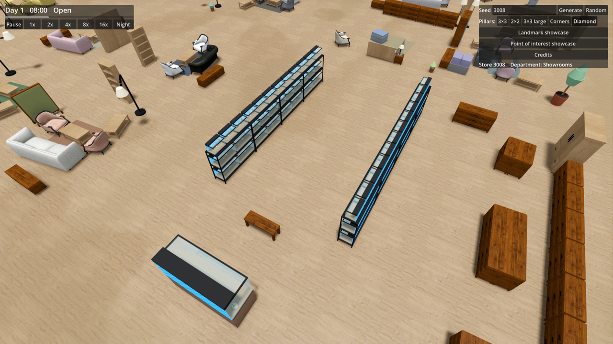
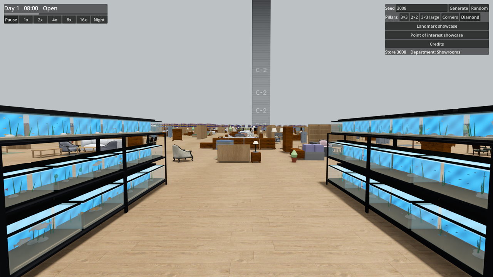
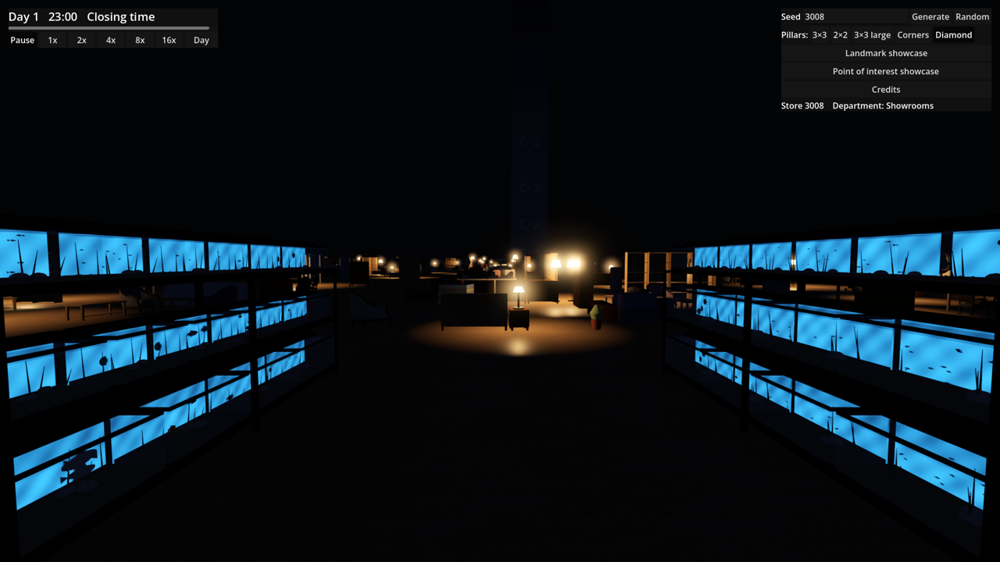

# Ticket 08h verification: Aquarium aisle, a row of tanks with different fish

## What was built

- **Core** (`PointOfInterest.cs`, `Furniture.cs`, `Generation/PointOfInterestGenerator.cs`, `WorldSnapshot.cs`, `Simulation.cs`).
  - The display aquarium is renamed to the Aquarium aisle (`PointOfInterestType.AquariumAisle`) everywhere: code, showcase button, docs. Its rectangle is 12 × 6 m; counts and placement rules are unchanged (1–2 per Store).
  - Two new Furniture types: `FishTank` in three sizes (small 0.6 m and medium 0.95 m for racks, large 2.4 × 1.9 m on its own cabinet) and `TankRack` (2 m steel rack, three shelves, `FurnitureCatalog.TankRackLevels`).
  - Layout: two rows of four racks face each other across the aisle. Medium tanks go on the bottom shelves, small ones on the top, and either on the middle. One or two large tanks close the east end, with a bench to watch them from.
  - Live fish are Goods, not Furniture: `WorldSnapshot.TankFish` lists one `TankFish(TankId, FishKind)` per tank. Eight kinds of fish (`FishKind`); each tank takes the next kind from a shuffled list, so neighbours differ.
- **Game**.
  - `FurnitureMeshes.cs`: procedural tanks (frame, lid, gravel, stones, plants, water block, glass) and racks; a fish school mesh per tank size and kind (`FishSchool`): body, tail and fins in the kind's colours, 1 betta to about 20 neon tetras.
  - `FurnitureRenderer.cs`: the fish are drawn apart from the Furniture, one instance group per (tank size, kind of fish), out to 60 m, without shadows and with no coarse mesh.
  - Three new shaders: `furniture_glass.gdshader` (transparent glass with a fresnel edge), `furniture_water.gdshader` (glowing blue water with moving caustics) and `furniture_fish.gdshader` (the fish swim back and forth, turn, wag their tails and bob, each school out of phase).
  - `SeedPanel.cs`: the showcase button is "Aquarium aisle".
- **Docs.** GLOSSARY.md already described the Aquarium aisle; the Goods entry now says the live fish are Goods and the tanks and racks Furniture. No ADR.

## Decisions

- The fish are only listed per tank (kind, not number): what they give Villagers and how Restock refills them belong to the simulation to come, like the other Points of interest' food and Goods.
- The water glows by emission (as the Lamp pools light other Furniture), so the aisle glows bluish at Closing time and in the dark without any real lights, which would cost frame rate.
- Glass, water and fish each have their own shader rather than branches in the shared `furniture.gdshader`. Reading the per-instance custom data for swimming in the shared shader doubled draw calls and primitives in the far views (1,660 → 3,054 draw calls), and a caustics branch there cost the LOD-switch view about 10 fps; on their own shaders both are free for every other piece.
- Far off, a tank's coarse mesh is its frame and a glowing water block; glass and fish are left out.
- Two coarse meshes from 08g (found by this stage's silhouette check): the Ball pit's net railing keeps its strands far off (slightly thicker, so the coarse mesh does not drop them), its top bar is a full-width block, and the coarse play ball is a block around the ball rather than inside it.
- Stage review (08c–08h): the Ball pit now draws its number of spilled balls once (8–20), rather than on every pass of the loop; the unused mannequin parameters and a stray comment are removed; README describes `TankFish`.
- All meshes are procedural, with no external models, so both CREDITS.md files are unchanged.

## Tests

- New facade-level tests in `PointOfInterestTests`, run on every Pillar layout and seeds 3008, 42 and 7:
  - 1–2 Aquarium aisles per Store (unchanged count), each 12 × 6 m with only tanks, racks and a bench: at least 3 tank sizes, one or two large tanks on the floor, every other tank on a rack shelf, at least 3 kinds of fish and different kinds in neighbouring tanks on a shelf;
  - every tank holds fish, and only tanks hold fish;
  - the display aquarium no longer exists, and fish are not a Furniture type.
- The existing placement tests (rectangles inside one Sector, clear of Displays, Landmarks and Pillars, pieces inside their rectangle) cover the Aquarium aisle on every layout unchanged.
- Full core suite: 429 passed, 0 failed.
- `dotnet build` of the game: 0 warnings, 0 errors. The Godot 4.7.2 console executable built the project headless (exit 0) and ran the game for the captures below.
- Silhouette check: the tanks and racks pass; after the fixes above all 114 Furniture types and variants pass.
- Coplanar check: 0 coplanar pairs. It used to stop on the model-drawn variants (such as the leather sofa, which has no procedural build); it now skips them, as the silhouette check does.
- Coarse-colour check: 188 of 188 pass. Model check: 10 models, 0 failed.

## Benchmark (RTX 2070 Super, 1080p, 20 s each; average / 1% low)

The same machine on the same day: 08g (HEAD, built in a temporary worktree) against this ticket's final code, run back to back.

| Measurement | 08g run 1 | 08g run 2 | 08h run 1 | 08h run 2 | 08h run 3 |
|---|---|---|---|---|---|
| Open | 128.1 / 73.4 | 126.0 / 67.9 | 103.1 / 38.6 | 123.7 / 60.6 | 124.0 / 60.2 |
| Closing time | 150.1 / 61.9 | 132.8 / 61.5 | 146.8 / 65.2 | 138.3 / 57.2 | 135.6 / 58.2 |
| Closing time far | 109.7 / 80.4 | 95.4 / 78.5 | 107.9 / 84.5 | 106.9 / 83.6 | 108.7 / 86.7 |
| Closing time at LOD switch | 103.2 / 79.2 | 83.7 / 67.6 | 100.7 / 67.2 | 100.3 / 68.9 | 99.9 / 71.3 |

- The averages match 08g, and so do draw calls and primitives (1,424 / 1,623 / 1,660 / 2,283 draw calls). Open and Closing time reach the 120 fps target; the two far views do not, as before.
- The 90 / 60 gate is noisy on this machine today: 08g itself failed it once (LOD switch 83.7). 08h failed it in its last two runs, on Closing time's 1% low (57.2 and 58.2, against 08g's 61.5–61.9); run 1's Open low (38.6) came with doubled CPU render time, i.e. something else on the machine. The fish are built once at load, with no per-frame work, and the benchmark path's draw calls are unchanged, so this reads as noise around the gate rather than a regression, but it is worth a human rerun on a quiet machine.
- With the Aquarium aisle in view, the capture ran at about 146 fps.

## Screenshots

- Observer camera, Aquarium aisle, seed 3008: 
- Eye level, the fish in the tanks: 
- Closing time (23:00), glowing blue in the dark: 

## Needs human review

- Whether it reads as a pet-shop aquarium aisle: the glass, the water colour and its caustics, the gravel, stones and plants.
- The fish: their shapes and colours per kind, and whether their swimming looks natural (a still screenshot cannot show it).
- The large tanks at the end of the row and the bench in front of them.
- Frame rate walking through the aisle close up, which the benchmark path does not cover, and a benchmark rerun on a quiet machine (Closing time's 1% low sits right at the 60 fps gate, for 08g as well).
