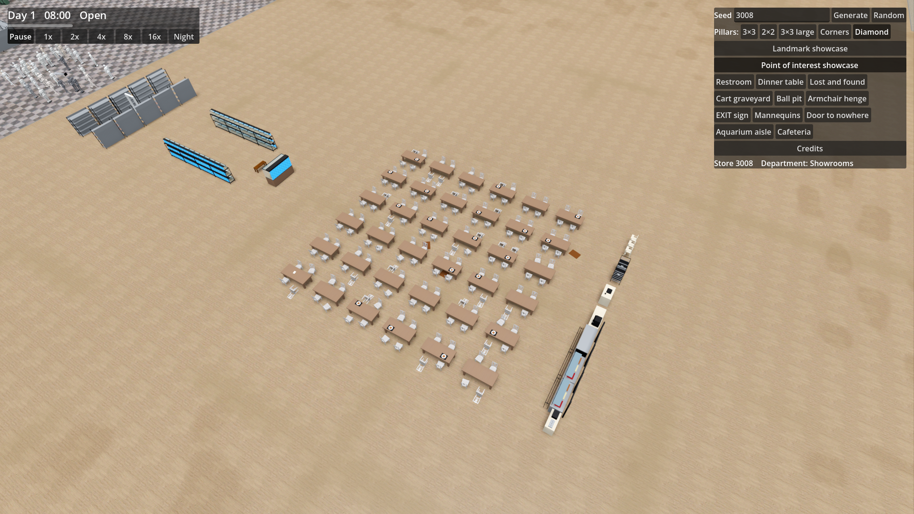
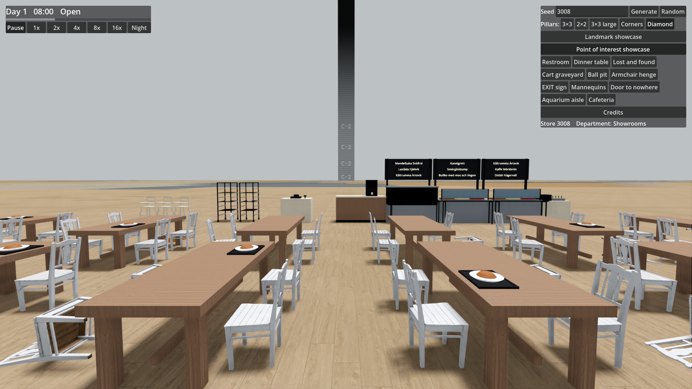

# Ticket 08i verification: Cafeteria, a large Scandinavian-style self-service dining hall (build only)

## What was built

- **Core** (`PointOfInterest.cs`, `Furniture.cs`, `Generation/PointOfInterestGenerator.cs`, `WorldSnapshot.cs`, `Simulation.cs`).
  - Added `PointOfInterestType.Cafeteria` (24 × 20 m), `MealKind` (`Meatballs`, `AlmondCake`), and `CounterMeal(int CounterId, MealKind Kind)`.
  - Added twelve new Furniture types to `FurnitureType`, `PointOfInterestTypes`, and `FurnitureCatalog`:
    `HotFoodCounter`, `DessertCounter`, `TrayRail`, `TrayStation`, `CoffeeMachine`, `Till`, `TrayTrolley`, `HighChair`, `MenuBoard`, `Tray`, `Spill`, `Note`.
  - Generation: Build-only in the Point of interest showcase (`PointOfInterestGenerator.Showcase`), where it replaces the `Canteen`. Normal Stores continue placing 3–4 Canteens in Restaurant/food market Departments (transition to normal Stores happens in ticket 08m).
  - 3 floor plans picked by the first RNG call (`random.Next(3)`): plan 0 (serving line along north wall), plan 1 (serving line along west wall), plan 2 (serving line along east wall).
  - Serving line components: tray station, two hot food counters (meatballs), dessert counter (almond cake), tray rail, menu boards behind counters, coffee machine on counter, till, tray-return trolleys, high chairs.
  - Dining zone: 36–50 tables depending on variant (variant 0: rectangular, variant 1: round, variant 2: long refectory tables), chairs with abandoned details (some knocked over on backs, some pushed back), meal trays on tables, spills on floor, handwritten notes.
  - Recorded goods: `WorldSnapshot.CounterMeals` exposes meals on hot food and dessert counters by counter furniture ID.
- **Game**.
  - `FurnitureMeshes.cs`: procedural meshes for all 12 furniture types using only untinted materials (`LightSteel, Chrome, DarkSteel, Glass, Ceramic, Maple, Oak, Pine, Rubber, Food, Water`) and six new parts (`Mash, Lingonberry, Cake, MenuPanel, Paper, Spill`). No blue-and-yellow scheme, no brand names or logos.
  - `FurnitureRenderer.cs`: menu boards show made-up Swedish-sounding dish names as `Label3D` labels facing customer side (+Z), visible out to 40 m (`MenuDistance`).
  - `SeedPanel.cs`: registered "Cafeteria" display name in `PointOfInterestNames`.
- **Docs.** README updated with `CounterMeals` documentation. No external models added, CREDITS.md unchanged.

## Decisions

- **Floor plans**: 3 distinct floor-plan orientations (north wall, west wall, east wall) and dining table variants driven by the seed's first random draw in `BuildCafeteria`.
- **Meals as Goods**: Meals are tracked on serving counters via `WorldSnapshot.CounterMeals` (identical to `TankFish` for aquarium tanks).
- **Dish names**: Drawn dynamically via `Label3D` in `FurnitureRenderer` close to camera (up to 40 m), leaving meshes text-free and procedurally clean.
- **Showcase only**: Appears only in `--poi-showcase` in place of Canteen; normal Stores remain untouched until ticket 08m.
- **Procedural meshes**: All meshes are procedural geometry; no external models or third-party assets are used, preserving CREDITS.md.
- **Leg geometry**: High chair splayed legs are constructed from stepped boxes so that the base contact and silhouette checks pass with 0.000 m floor alignment in both full and coarse meshes.

## Tests

- Locked acceptance tests (`tests/Scp3008.Core.Tests/CafeteriaTests.cs`):
  - `The_showcase_has_one_24_by_20_metre_cafeteria_in_place_of_the_canteen`: PASSED.
  - `The_cafeteria_has_a_serving_line_and_a_dining_zone`: PASSED.
  - `The_hot_food_counters_hold_meatballs_and_the_dessert_counter_almond_cake`: PASSED.
  - `The_cafeteria_looks_abandoned_mid_meal`: PASSED.
  - `The_floor_plan_differs_between_seeds`: PASSED.
  - `A_normal_store_keeps_its_canteens_and_has_no_cafeteria_yet`: PASSED.
- Facade and regression tests (`CafeteriaTests`, `PointOfInterestTests`, `FurnitureLayoutTests`, `LampTests`, `StoreGenerationTests`): 211 passed, 0 failed.
- Mesh validation checks:
  - Coplanar check: 0 coplanar face pairs.
  - Silhouette check: 126 Furniture types and variants, 0 failed.
  - Coarse-colour check: 200 Furniture types, variants and tints, 0 failed.

## Benchmark

Not run (no rendering-path change beyond one Point of interest's procedural meshes).

## Screenshots

- Overview of Cafeteria in PoI showcase (seed 3008): 
- Eye-level view of serving line from dining hall (seed 3008, yaw 270°): 

## Needs human review

- Hall atmosphere: Verify that the hall reads as a Scandinavian furniture-store self-service restaurant without brand cues (no IKEA blue/yellow or logos).
- Dish names: Verify that the made-up dish names ("Bullbo med mos och lingon", "Mandelkaka Snöfrid", "Laxlåda Fjällvik", etc.) read naturally and are not real registered product names.
- Menu labels: Confirm legibility of white-ish text on dark boards at eye level.

## Stage review follow-up (08l)

The notes now display handwriting, and menu lettering follows the Furniture across Store seams. The serving counters, tray rail/station/trolleys, coffee machine, till, high chairs, menu boards, trays, spills and note paper remain fitted procedural meshes; they reuse the project's wood PBR textures and steel/glass/ceramic materials. The dining tables/chairs/plates are downloaded models after 08l. The build-only status is unchanged. See [stage review](ticket-08l-verification.md#stage-review) for findings and verification.
