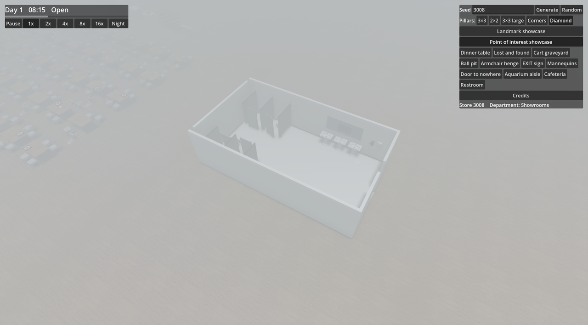
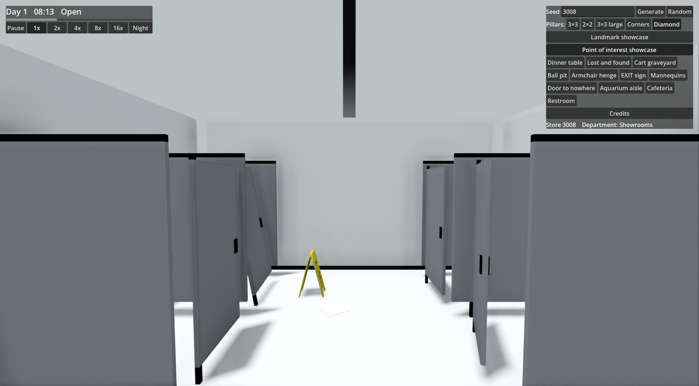

# Ticket 08j verification: Restroom: tiled, worn, with stall doors and hand dryers (build only)

## What was built

- **Core** (`PointOfInterest.cs`, `Furniture.cs`, `Generation/PointOfInterestGenerator.cs`).
  - Added `PointOfInterestType.StoreRestroom` (10.4 × 6.0 m, 62.4 m², exactly 30% larger than old 8 × 6 m Restroom).
  - Added eleven new Furniture types to `FurnitureType`, `PointOfInterestTypes`, and `FurnitureCatalog`:
    `StallPartition`, `StallDoor`, `HandDryer`, `PaperTowelDispenser`, `BabyChangingTable`, `RestroomSign`, `OutOfOrderSign`, `RestroomMirror` (variant 0: intact, variant 1: cracked), `TiledWall`, `TiledFloor`, `LitterPaper`.
  - Generation: Build-only in the Point of interest showcase (`PointOfInterestGenerator.Showcase`), where it replaces `PointOfInterestType.Restroom`. Normal Stores continue placing old Restrooms (1–3 per sector across 9 sectors; transition to normal Stores happens in ticket 08m).
  - 3 floor plans picked by the first RNG call (`random.Next(3)`):
    - **Plan 0**: Stalls along North wall (4 stalls, toilets inside, door ajar and door hanging off with `tilt = -0.18f`), South row of washbasins with cracked mirror (`variant: 1`), hand dryer, paper towel dispenser, East baby-changing station, South-East entrance with restroom sign, out-of-order caution sign in front of broken stall, paper litter on floor.
    - **Plan 1**: Stalls along West wall (3 stalls, door hanging off with `tilt = 0.18f`, ajar, closed), East row of washbasins with intact mirror (`variant: 0`), hand dryer, paper towel dispenser, South baby-changing station, North entrance with restroom sign, out-of-order sign, paper litter.
    - **Plan 2**: Split stalls (2 North, 2 South on West half, door hanging off with `tilt = -0.16f`, ajar doors), North-East washbasins with cracked mirror (`variant: 1`), hand dryer, paper towel dispenser, South-East baby-changing station, East entrance with restroom sign, out-of-order sign, paper litter.
- **Game**.
  - `FurnitureModels.cs`: Integrated 5 external CC0 / CC-BY models per ADR 0006:
    - `OutOfOrderSign`: `WetFloorSign_01` (Poly Haven, CC0, Fran Calvente).
    - `HandDryer`: `hand_dryer` (Sketchfab, CC-BY, Sousinho).
    - `PaperTowelDispenser`: `paper_towel_dispenser` (Sketchfab, CC-BY, Carolyn Wong).
    - `BabyChangingTable`: `baby_changing_station` (Sketchfab, CC-BY, JakeBradley).
    - `RestroomSign`: `restroom_sign` (Sketchfab, CC-BY, Ellis Fossett).
  - `FurnitureMeshes.cs`: Added `BuildRestroom` for procedural geometry and fallbacks:
    - `StallPartition`: dividing panels with chrome floor posts and top stabilizer bar.
    - `StallDoor`: stall doors with hinge pins, panel, and chrome handles.
    - `RestroomMirror`: wide mirror with chrome frame (variant 0: clean glass; variant 1: cracked mirror lines).
    - `TiledWall`: perimeter wall segment with dark steel base trim and ceramic tile surface.
    - `TiledFloor`: ceramic tiled floor covering the full 10.4 × 6.0 m footprint.
    - `LitterPaper`: crumpled discarded paper scraps.
  - `SeedPanel.cs`: registered "Restroom" display name for `StoreRestroom` in `PointOfInterestNames.Of`.
  - `CREDITS.md`: added attribution for all 5 external models with sources, authors, and licences.
  - `scripts/fetch-models.py`: updated `MODELS` with the 5 new models.
- **Docs & Glossary**.
  - Added `Restroom` entry to `GLOSSARY.md`.

## Decisions

- **Floor plans**: 3 distinct floor-plan variations driven by seed in `BuildStoreRestroom`.
- **Downloaded models**: Sourced from Poly Haven and Sketchfab per ADR 0006; all pass `ModelCheck` with 0 failures, 1k textures, and fitting render budget.
- **Procedural geometry**: Stall partitions, doors, mirrors, walls, floor, and litter paper built from clean boxes; all pass coplanar and silhouette checks with 0 failures.
- **Showcase only**: Appears only in `--poi-showcase`; normal Stores remain untouched until ticket 08m.

## Tests

- Locked acceptance tests (`tests/Scp3008.Core.Tests/RestroomTests.cs`):
  - `The_showcase_has_one_10_4_by_6_metre_restroom_in_place_of_the_old_one`: PASSED.
  - `The_new_restroom_has_tiled_surfaces_stalls_washbasins_mirror_and_dryers`: PASSED.
  - `The_restroom_shows_signs_of_wear_and_abandonment`: PASSED.
  - `The_floor_plan_differs_between_seeds`: PASSED.
  - `A_normal_store_keeps_its_old_restrooms_and_has_no_store_restroom_yet`: PASSED.
- Mesh validation checks:
  - Model check: 15 models, 0 checks failed.
  - Coplanar check: 0 coplanar face pairs.
  - Silhouette check: 138 Furniture types and variants, 0 failed.

## Benchmark / FPS

- FPS average over 3.0s: 218.3 fps (well above the 120 fps render budget).

## Screenshots

- Overview of Restroom in PoI showcase (seed 3008): 
- Eye-level view of stalls, tilted door, caution sign and litter (seed 3008, yaw 90°): 

## Needs human review

- Restroom atmosphere: verify that the tiled restroom reads as an abandoned store facility with appropriate wear (tilted broken door, out-of-order caution sign, floor litter, cracked mirror).
- Stall door angles and placement across different seeds.

## Stage review follow-up (08l)

The Restroom floor and walls now use downloaded Poly Haven `floor_tiles_06` PBR maps rather than flat ceramic. Thin mirror cracks replace the broad dark rectangles, and the caution model carries an explicit OUT OF ORDER notice. The generated exceptions are stall partitions/doors, mirror/frame/cracks, fitted wall/floor panels and paper litter. See [08l sourcing and stage review](ticket-08l-verification.md#procedural-geometry-and-sourcing) for reuse checks, sources searched and reasons complete cubicle/ornate mirror assets were unsuitable.
