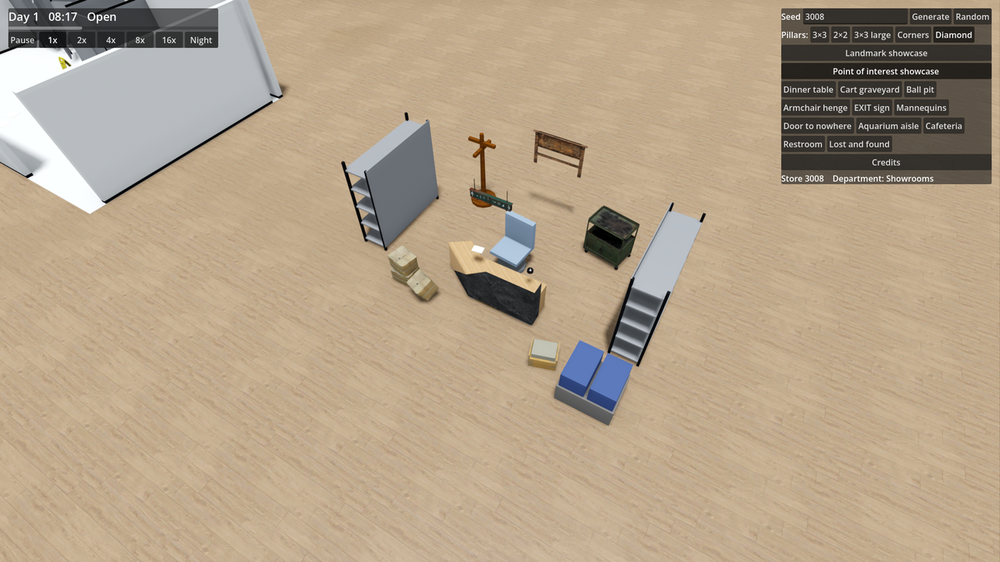
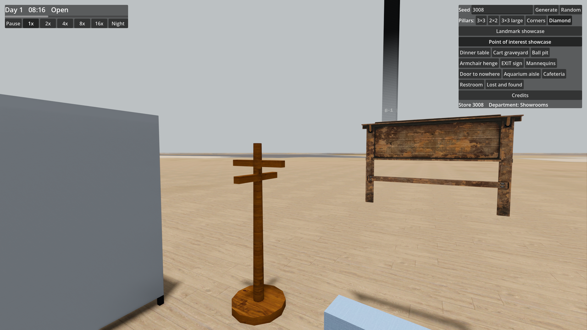

# Ticket 08k verification: Lost and found: labelled boxes and a notice board (build only)

## What was built

- **Core** (`PointOfInterest.cs`, `Furniture.cs`, `Generation/PointOfInterestGenerator.cs`).
  - Added `PointOfInterestType.LostAndFound` (6.5 × 5.0 m, 32.5 m², exactly 30% larger than old 5.0 × 5.0 m, 25.0 m² `LostAndFoundDesk`).
  - Added six new Furniture types to `FurnitureType`, `PointOfInterestTypes`, and `FurnitureCatalog`:
    `ServiceCounter`, `ServiceBell`, `LabelledBox` (variant 0: closed labelled box; variant 1: open/spilled box with fabric contents), `UnsortedCart`, `NoticeBoard`, `LostAndFoundSign`.
  - Added to `FurnitureCatalog.PointOfInterestTypes` so they are recognized as Point of interest props.
  - Generation: Build-only in the Point of interest showcase (`PointOfInterestGenerator.Showcase`), where it replaces `PointOfInterestType.LostAndFoundDesk`. Normal Stores continue placing old `LostAndFoundDesk` until ticket 08m.
  - 3 floor plans picked deterministically by seed (`random.Next(3)`):
    - **Plan 0**: Service counter facing South-East with "back in 5 min" handwritten note, service bell, chair, shelving units on North/West walls with labelled boxes, coat rack, notice board on North-East, unsorted wire cart, toppled box pile, open spilled box with contents, luggage/totes, and Lost & Found hanging sign.
    - **Plan 1**: Service counter along North wall facing South, note, service bell, chair, shelving along East and West walls with labelled boxes, coat rack on West, notice board on North wall, central unsorted cart, toppled boxes, open box, luggage, and hanging sign.
    - **Plan 2**: Angled service counter on West side facing East, note, service bell, chair, shelving along North and East walls with labelled boxes, coat rack, notice board, unsorted cart, toppled box pile, open box, luggage, and hanging sign.
- **Game**.
  - `FurnitureModels.cs`: Integrated 6 external CC0 / CC-BY models per ADR 0006:
    - `LabelledBox`: `cardboard_box_01` (Poly Haven, CC0, Rahul Chaudhary).
    - `UnsortedCart`: `industrial_storage_cart` (Poly Haven, CC0, Jule Bielitz).
    - `ServiceBell`: `desk_bell` (Sketchfab, CC-BY, ClintonAbbott.Art).
    - `NoticeBoard`: `notice_board` (Sketchfab, CC-BY, Mehdi Shahsavan).
    - `LostAndFoundSign`: `lost_and_found_sign` (Sketchfab, CC-BY, Sousinho).
    - `ServiceCounter`: `service_counter` (Sketchfab, CC-BY, DZigner).
  - Robustness enhancements in `FurnitureModels.cs`:
    - Safely skips non-triangle primitives from ArrayMesh (`am.SurfaceGetPrimitiveType(s) != Mesh.PrimitiveType.Triangles`).
    - Validates triangle index count (`indices.Length % 3 == 0`).
  - `FurnitureMeshes.cs`: Added `BuildLostAndFound` procedural geometry fallbacks for all six new furniture types (`ServiceCounter`, `ServiceBell`, `LabelledBox`, `UnsortedCart`, `NoticeBoard`, `LostAndFoundSign`).
  - `SeedPanel.cs`: Registered display name `"Lost and found"` for `PointOfInterestType.LostAndFound`.
  - `CREDITS.md`: Added full attribution for all 6 external models with links, authors, and CC0/CC-BY licences.
  - `scripts/fetch-models.py`: Added entries for all 6 new models.
- **Docs & Glossary**.
  - Added `Lost and found` definition and avoid rule to `GLOSSARY.md`.

## Decisions

- **Floor plans**: 3 distinct floor-plan variations driven by seed in `BuildLostAndFoundServicePoint`.
- **Downloaded models**: Sourced from Poly Haven and Sketchfab per ADR 0006; all 6 pass `ModelCheck` with 0 failures, 1k textures, and fitting render budgets.
- **Signs of abandonment**: Handwritten "back in 5 min" paper note on the counter, toppled box pile, and open spilled box (`variant: 1`) spilling fabric onto the floor.
- **Showcase replacement**: Replaces `LostAndFoundDesk` in `PointOfInterestGenerator.Showcase`; normal Stores continue placing `LostAndFoundDesk` until ticket 08m.

## Tests

- Locked acceptance tests (`tests/Scp3008.Core.Tests/LostAndFoundTests.cs`):
  - `The_showcase_has_one_6_5_by_5_metre_lost_and_found_in_place_of_the_old_desk`: PASSED.
  - `The_new_lost_and_found_has_counter_boxes_coat_rack_and_notice_board`: PASSED.
  - `The_lost_and_found_shows_signs_of_abandonment`: PASSED.
  - `The_floor_plan_differs_between_seeds`: PASSED.
  - `A_normal_store_keeps_its_old_lost_and_found_desk_and_has_no_new_lost_and_found_yet`: PASSED.
  - `Every_lost_and_found_piece_in_the_showcase_stays_inside_its_rectangle_and_on_the_floor_or_a_surface`: PASSED.
- Full Core Test Suite (`dotnet test tests/Scp3008.Core.Tests -c Release`):
  - 510 tests passed, 0 failed, 0 skipped.
- Mesh validation checks:
  - Model check (`--model-check`): 21 models, 0 checks failed.
  - Coplanar check (`--coplanar-check`): 0 coplanar face pairs.
  - Silhouette check (`--silhouette-check`): 145 Furniture types and variants, 0 failed.

## Benchmark / FPS

- FPS average over 3.0s: 209.6 fps (well above the 120 fps target).

## Screenshots

- Overview of Lost and found in PoI showcase (seed 3008): 
- Eye-level view of coat rack and notice board (seed 3008, yaw 30°): 

## Needs human review

- Visual appearance and layout of the counter, notice board, and shelving in the showcase scene.
- Signs of abandonment readability: hand-written note on counter, toppled boxes, open box, and wire cart.
